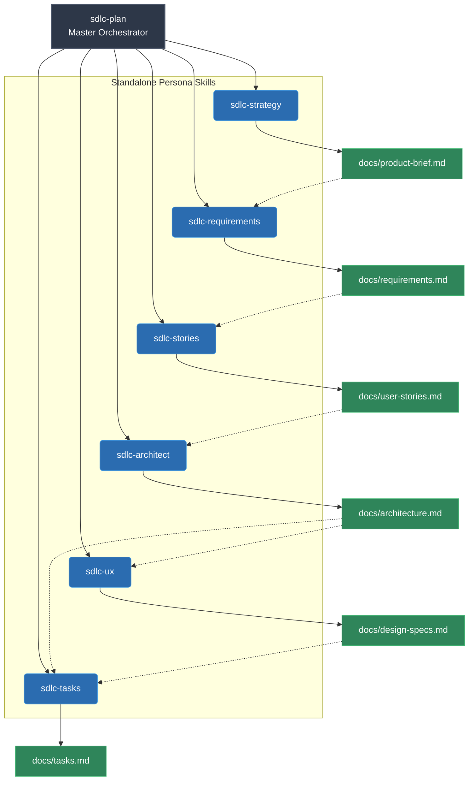
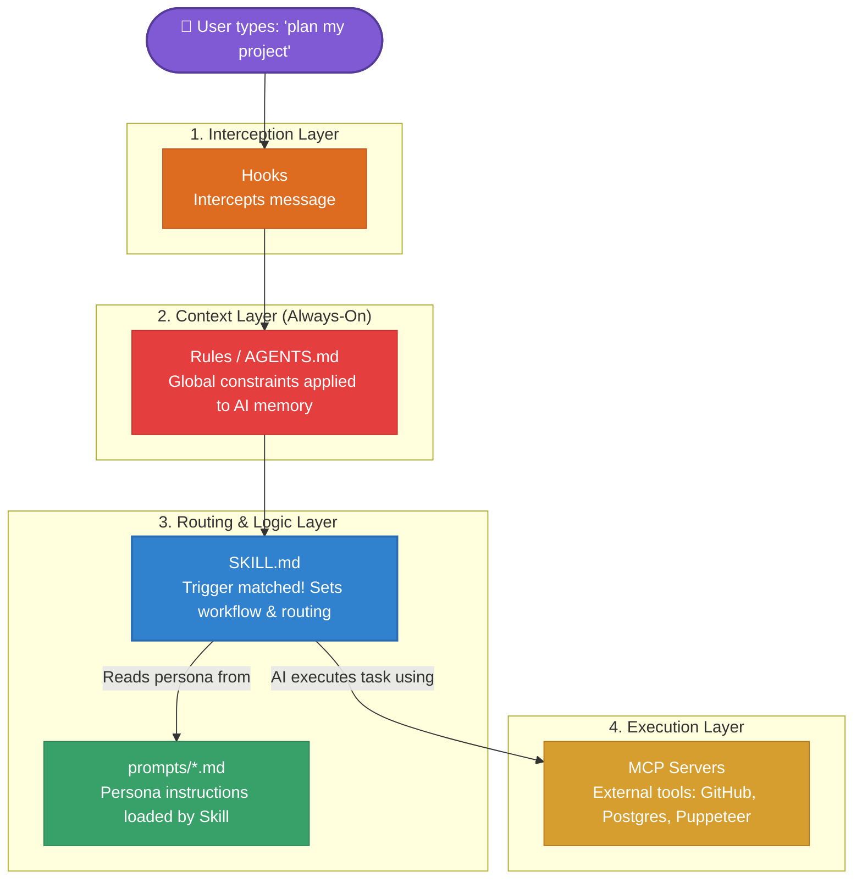

# AI Dev Pipeline

[](https://www.npmjs.com/package/@kadvsperera/ai-dev-pipeline)
[](https://github.com/vdsperera/ai-dev-pipeline/actions/workflows/ci.yml)
[](https://www.npmjs.com/package/@kadvsperera/ai-dev-pipeline)
[](LICENSE)
[](https://nodejs.org/)

> **The Agentic SDLC Governance Framework for AI Coding Agents.**  
> Delivered through a zero-friction CLI (`npx @kadvsperera/ai-dev-pipeline init`) with native parity across **Google Antigravity**, **Cursor**, **Claude Code**, and **GitHub Copilot**.

`ai-dev-pipeline` transforms AI from an erratic code generator into a disciplined, 17-role software engineering organization. It enforces living architecture contracts (`docs/architecture.md`), strict quality gates (`AGENTS.md`), persistent defect memory (`docs/anti-patterns.md`), and deterministic reliability scoring (`ai-dev-pipeline eval`) directly inside your daily code editor.

## How it works

The pipeline has **17 specialised agent personas** packaged as **16 skills** and 1 always-on rule. The 6 planning agents can be invoked individually as standalone skills or chained together via `sdlc-plan`. Instead of copy-pasting between separate AI chat windows, you invoke skills by name and the agent runs automatically.

```
Your idea
    ↓ "plan my project: [idea]"
product-brief.md → requirements.md → user-stories.md → architecture.md
    ↓ (has UI?) → design-specs.md
    ↓ → tasks.md (auto-bootstraps TASK-001 for linters/toolchain)
    ↓ "implement TASK-001"
Code + unit tests + handoff note (supports [REFACTOR] mode & drift tracking)
    ↓ "review TASK-001"
Linter pre-check → Code review → Security review (if applicable) → UX review (if applicable)
    ↓ "test TASK-001"
Full test suite + coverage matrix → task marked done
    ↓ "deploy TASK-001" (optional)
Dockerfile + CI/CD + deployment review
    ↓ "document TASK-001" (optional)
API docs + README update + changelog + architecture drift sync
    ↓ repeat for next task
```

For existing codebases or runtime issues, the pipeline provides specialized lifecycle entry points:
- **Brownfield onboarding:** `"onboard this repo"` → scans existing code and reverse-engineers `docs/architecture.md`.
- **Bug investigation:** `"debug this: [error]"` → scientific RCA, failing reproduction test first, minimal fix.

### Mental Model: Skills (On-Demand) vs. Always-On Rules (`AGENTS.md`)

To understand how the pipeline operates, think of the distinction between **the job** and **the law**:

| Component | Nature | When It Triggers | What It Controls |
|---|---|---|---|
| **16 Skills** (`.agents/skills/`) | **On-Demand** | Triggered only when you say phrases like `"plan my project"`, `"implement TASK-001"`, or `"debug this"`. | **WHAT task to do**: Orchestrates multi-agent chains, creates task backlogs, runs code reviews, and writes reports into `docs/`. |
| **Always-On Rules** (`.agents/AGENTS.md`) | **Always-On** | Injected automatically on **100% of interactions** (every prompt, every skill, and every ad-hoc question). | **HOW the code must be written**: Enforces baseline engineering law across all tools (typed error handling, parameterized SQL, no console.log, zero linter errors, and anti-pattern memory). |

---

## Scope: The Engineering Pillar

This pipeline focuses strictly on the **Software Development Life Cycle (SDLC)**. It is an engineering factory that turns an idea into working, tested, and deployable code.

It does **not** cover the other two pillars of creating a successful product:
1. **Business & Go-To-Market:** Market research, customer discovery, marketing, legal, or pricing.
2. **Operations & Support:** Customer support, community management, or analytics.

If you are looking to build the technical foundation of your product, this pipeline handles it end-to-end.

## Why Architecture & Traceability Matter (The "Black-Box AI" Solution)

Modern AI coding assistants can generate code in seconds, but they introduce a critical liability: **code without context**. Developers end up with thousands of lines of generated code where nobody understands the design trade-offs, scaling limits, or failure modes. When technical leaders, clients, or auditors evaluate such projects, the lack of explainable reasoning is immediately evident.

The AI Dev Pipeline solves this by positioning the developer as the **Lead Architect** and the AI agents as a disciplined engineering team:

* **Every architectural decision is defensible:** Architecture Decision Records (ADRs in `docs/architecture.md`) explicitly capture why an approach was chosen, what alternatives were evaluated, and what trade-offs were accepted.
* **Full paper trail per task:** Developer handoff notes (`docs/handoffs/`), Gherkin acceptance criteria (`docs/user-stories.md`), and automated drift checks guarantee you can always explain and defend *how* and *why* your system functions.
* **Instant brownfield visibility (`sdlc-onboard`):** Reverse-engineer any legacy or existing codebase to surface architectural risks, dependency bottlenecks, and tech debt before touching a line of code.
* **Scientific debugging (`sdlc-debug`):** Enforce root-cause analysis with automated failing reproduction tests before applying fixes—preventing "guess-and-check" hallucinated patches.

### Interrogating & Defending Your Architecture

A resilient architecture is one you can explain and defend under scrutiny. You can use the AI assistant to conduct **Architecture Defense & Stress-Testing sessions** before presenting your project to an Architecture Review Board (ARB), technical lead, or auditor:

#### Workflow A: For projects built with this pipeline
If you built the project using the pipeline, your design reasoning is already recorded in `docs/architecture.md` and `docs/handoffs/`. You can immediately run the stress-test prompts below.

#### Workflow B: For projects built WITHOUT this pipeline (legacy or external code)
If you are working with an existing codebase that has no documentation:
1. Run: `"onboard this repo"` (`sdlc-onboard`).
2. The agent scans the code and reverse-engineers a baseline `docs/architecture.md` with component maps, implicit ADRs, and risk flags.
3. Once generated, run the stress-test prompts below to interrogate the codebase.

#### Architecture Defense Prompts

| To stress-test... | Say this to the assistant |
|-------------------|---------------------------|
| **Technology Trade-Offs** | *"Review `docs/architecture.md` and challenge me on our tech stack choices. What alternatives could we have chosen and what are the trade-offs?"* |
| **Scaling Bottlenecks** | *"If this system experiences a 10x surge in traffic, which component or query breaks first and why?"* |
| **Failure Modes & Resilience** | *"Walk me through what happens when [External Dependency / Database] fails or times out. How does our error handling prevent cascading failure?"* |
| **Simulated Technical Defense** | *"Act as a Principal Systems Architect reviewing this project. Grill me on our data ownership and boundary isolation, asking one challenging question at a time."* |

### Tracking Ideas, Bugs & Optional GitHub Sync

During development, you will inevitably discover new possibilities, non-blocking bugs, or postponed features. 

* **The Local Default (Zero Setup & Offline)**:  
  By default, `ai-dev-pipeline` tracks everything locally in your Git repository with zero external dependencies:
  * **Tasks & Backlog**: Captured in `docs/tasks.md` under `## Deferred / Future Scope`.
  * **Follow-ups & Limitations**: Documented in `docs/handoffs/TASK-NNN.md` when closing a task.
  * **AI Mistakes & Defect Patterns**: Logged permanently in `docs/anti-patterns.md`.

* **Optional: On-Demand GitHub Issue Sync (via MCP)**:  
  If you have the **GitHub MCP Server** configured in your editor (or signed in via Antigravity/Cursor), you can trigger issue syncing on demand:
  * *"Create a GitHub issue for the CSV export task we just deferred."*
  * *"Import open GitHub issues into `docs/tasks.md` as new backlog tasks."*
  * *"Add a comment to issue #12 with our RCA findings from `sdlc-debug`."*

> [!NOTE]
> GitHub sync is **strictly on-demand, never automatic**. The pipeline will never demand API tokens, send unsolicited network requests, or pester you to connect external accounts—local Markdown files remain the 100% offline source of truth.

---

## Where This Fits: The 3-Layer AI Coding Stack

To understand where `ai-dev-pipeline` sits in the software industry, it helps to view the modern AI coding ecosystem as three distinct layers:

```
┌────────────────────────────────────────────────────────┐
│  LAYER 3: GOVERNANCE & SDLC FRAMEWORK                  │
│  👉 AI Dev Pipeline                                    │
│  (17 specialized roles, architecture contracts, evals) │
├────────────────────────────────────────────────────────┤
│  LAYER 2: THE EDITOR / INTERFACE (The Hands)           │
│  Cursor, Google Antigravity, Claude Code, Copilot      │
├────────────────────────────────────────────────────────┤
│  LAYER 1: THE FOUNDATION MODEL (The Brain)             │
│  Claude 3.5 Sonnet, Gemini 2.0, GPT-4o                 │
└────────────────────────────────────────────────────────┘
```

* **Layer 1 (The Brain)** provides raw model intelligence, but lacks persistent context of your team's engineering process or past mistakes.
* **Layer 2 (The Hands)** gives the AI access to read files, edit code, and run terminals, but doesn't tell it *how* to build clean, maintainable software.
* **Layer 3 (The Engineering System — AI Dev Pipeline)** organizes the hands and brains into a disciplined 17-role software engineering factory with living architecture contracts (`docs/architecture.md`), quality gates (`AGENTS.md`), continuous anti-pattern memory, and objective evaluations (`ai-dev-pipeline eval`).

### Category Comparison

| Category | Example Tools | How It Works | How AI Dev Pipeline Differs |
|---|---|---|---|
| **AI Editors / IDEs** | Cursor, Antigravity, VS Code | Provides file editing and inline completion in your editor. | We are the **operating system of rules, roles, and workflows** that runs *inside* those editors. |
| **Toy Agent Simulators** | ChatDev, MetaGPT | Autonomous agents chatting in a loop to build toy sandbox games. | Built for **real-world, multi-thousand-line brownfield codebases** with human-in-the-loop approvals. |
| **Autonomous Cloud Coders** | Devin, OpenHands | Cloud VMs attempting to solve GitHub issues with zero supervision. | Lightweight, **in-editor pair programming harness** with deterministic evaluations and zero cloud lock-in. |
| **Agentic SDLC Governance** | **AI Dev Pipeline** | **End-to-end engineering harness: Architecture contracts, quality gates, anti-pattern memory & evals.** | **This is our exact category.** |

### Division of Responsibility (Human-in-the-Loop)

* **What the Pipeline Handles**: Reverse-engineering unknown code, drawing visual Mermaid diagrams, enforcing typed errors & zero-linter gates, preventing SQL injection, generating test suites, and scoring code reliability.
* **What You (the Human) Own**: Business context & domain priorities, credentials/secrets configuration, and final production deployment sign-off.

### When to Use (and When NOT to Use)

| When to Use AI Dev Pipeline | When NOT to Use It |
|---|---|
| **Multi-thousand-line production repos** where regressions, silent bugs, and architectural drift break real features. | **50-line throwaway scripts** or weekend hackathon prototypes where architectural overhead is unnecessary. |
| **Brownfield codebases** that need reverse-engineering (`sdlc-onboard`) before making safe modifications. | **Unsupervised "black box" cloud coding** where you expect an autonomous bot to write code while you sleep. |
| **Engineering teams & serious solo devs** who need living architecture contracts, zero-linter gates, and persistent defect memory. | **Trivial single-file edits** where quick inline completion (Tab in Cursor/Copilot) is sufficient. |

#### The Honest Engineering Trade-Offs
* **Token & API Cost**: Loading contracts, anti-patterns, and chained personas uses **3x–5x more tokens** than raw prompts.
* **Maintenance Discipline**: Living documents (`docs/architecture.md`, `docs/anti-patterns.md`) must be kept up to date or contracts will drift.
* **Garbage-In, Garbage-Out**: A disciplined pipeline will implement a flawed architectural contract just as faithfully as a good one—human review at the architecture gate remains mandatory.

> [!TIP]
> For a deep dive into our engineering philosophy, honest trade-offs, and how we compare against BMAD-METHOD and GitHub Spec Kit, read our [Frequently Asked Questions (FAQ)](docs/faq.md).

---

## End-to-End Reference Walkthroughs

Explore realistic reference scenarios demonstrating how the pipeline governs greenfield microservices and brownfield bug investigations:

| Reference Scenario | Problem Domain | What It Demonstrates |
|---|---|---|
| [**01: Greenfield Microservice Design**](docs/case-studies/01-greenfield-microservice.md) | Distributed Token Bucket Rate Limiter | End-to-end trace from raw idea to PR review: Redis Lua script atomicity, fail-open circuit breakers, Gherkin acceptance criteria, and zero magic numbers. |
| [**02: Brownfield Bug Investigation & RCA**](docs/case-studies/02-brownfield-bug-rca.md) | Legacy E-Commerce Connection Pool Leak | Reverse-engineering legacy architecture (`sdlc-onboard`), 5-Whys root cause analysis, writing a failing reproduction test first (`sdlc-debug`), surgical minimal fix, and registering permanent anti-pattern memory. |

---

## Folder structure

```
.
├── bin/                                # CLI executables
│   └── cli.js                          # npx ai-dev-pipeline entry point
├── .agents/                            # Antigravity customization root
│   ├── AGENTS.md                       # Always-on coding standards & static analysis (Agent 6)
│   ├── mcp_config.json                 # Optional MCP integrations (GitHub, Postgres, etc.)
│   └── skills/
│       ├── sdlc-plan/SKILL.md          # Planning chain (Agents 0→1→2→3→4→5)
│       ├── sdlc-strategy/SKILL.md      # Product strategy (Agent 0) — standalone
│       ├── sdlc-requirements/SKILL.md  # Requirements analysis (Agent 1) — standalone
│       ├── sdlc-stories/SKILL.md       # User story writing (Agent 2) — standalone
│       ├── sdlc-architect/SKILL.md     # Architecture design & flavors (Agent 3) — standalone
│       ├── sdlc-ux/SKILL.md            # UI/UX design (Agent 4) — standalone
│       ├── sdlc-tasks/SKILL.md         # Task planning & toolchain bootstrap (Agent 5) — standalone
│       ├── sdlc-develop/SKILL.md       # Task implementation & refactor mode (Agent 6)
│       ├── sdlc-review/SKILL.md        # Code + Security + UX review & strictness (Agents 7→8→9)
│       ├── sdlc-test/SKILL.md          # Test generation (Agent 10)
│       ├── sdlc-deploy/SKILL.md        # DevOps review & artifacts (Agent 13)
│       ├── sdlc-docs/SKILL.md          # Documentation generation & drift sync (Agent 14)
│       ├── sdlc-onboard/SKILL.md       # Brownfield codebase onboarding (Agent 15)
│       ├── sdlc-debug/SKILL.md         # Root-cause analysis & bug fixing (Agent 16)
│       ├── pr-review/SKILL.md          # PR review at merge gate (Agent 11)
│       └── pr-triage/SKILL.md          # Large PR triage (Agent 12)
├── prompts/                            # Source of truth for all agent instructions
│   ├── 00-product-strategist.md       # Business thinking, MVP scope
│   ├── 01-requirements-analyst.md
│   ├── 02-user-story-writer.md
│   ├── 03-architect.md
│   ├── 04-ux-designer.md             # Design system, component specs, user flows
│   ├── 05-task-planner.md
│   ├── 06-developer.md
│   ├── 07-code-reviewer.md            # Includes Data & Schema review
│   ├── 08-security-reviewer.md        # Includes Regulatory Compliance
│   ├── 09-ux-accessibility-reviewer.md # WCAG 2.1 AA, responsive, UX
│   ├── 10-test-generator.md           # Enhanced performance testing
│   ├── 11-pr-reviewer.md
│   ├── 12-large-pr-triage.md
│   ├── 13-devops-agent.md             # Dockerfile, CI/CD, IaC
│   ├── 14-documentation-agent.md      # API docs, README, changelog
│   ├── 15-codebase-onboarder.md       # Reverse-engineer architecture from code
│   └── 16-bug-investigator.md         # Scientific RCA, reproduction test first
├── scripts/                            # Automation & cross-tool synchronizers
│   ├── sync-tools.js                  # Syncs AGENTS.md → CLAUDE.md, .cursorrules & Copilot
│   └── sync-tools.ps1                 # PowerShell synchronizer
├── package.json                        # CLI package manifest & bin definition
├── CLAUDE.md                           # Generated for Claude Code (via sync-tools)
├── .cursorrules                        # Generated for Cursor (via sync-tools)
└── docs/                               # Living project documents (pipeline outputs)
    ├── case-studies/                    # Detailed end-to-end greenfield & brownfield walkthroughs
    ├── pipeline-roadmap.md              # Architectural principles, quality controls & roadmap
    ├── anti-patterns.md                 # Lessons learned & recurring AI mistakes to avoid
    ├── product-brief.md                 # Agent 0 output
    ├── requirements.md                  # Agent 1 output
    ├── user-stories.md                  # Agent 2 output
    ├── architecture.md                  # Agent 3 output
    ├── design-specs.md                  # Agent 4 output (conditional — UI projects only)
    ├── tasks.md                         # Agent 5 output — your task backlog
    ├── handoffs/                        # Agent 6 handoff notes per task
    ├── reviews/                         # Agent 7+8+9 review reports per task
    ├── test-reports/                    # Agent 10 test reports per task
    ├── deploy/                          # Agent 13 deployment reports per task
    └── documentation/                   # Agent 14 documentation reports per task
```

---

## Setup & Quickstart

The AI Dev Pipeline can be installed via a **one-line CLI scaffolder** or configured manually:

### ⚡ Instant Setup: One-Line CLI Scaffolder (Recommended)

Inject the complete AI Dev Pipeline into any existing or new project in seconds without cloning:

```bash
# Interactive wizard (prompts for your AI editors, project type & architecture style):
npx @kadvsperera/ai-dev-pipeline init

# Or zero-config instant install with sensible defaults:
npx @kadvsperera/ai-dev-pipeline init -y
```

This scaffolds the 17 agent personas, 16 skills, docs roadmap, anti-patterns memory, and native configuration files tailored to your selected AI tools (**Antigravity**, **Cursor**, **Claude Code**, and **GitHub Copilot**).

#### Built-in CLI Utilities:
```bash
# Check pipeline health, installed personas, and tool rule status:
npx @kadvsperera/ai-dev-pipeline status

# Evaluate stage outputs for architectural drift and anti-pattern regressions:
npx @kadvsperera/ai-dev-pipeline eval

# Run strict CI quality gate on specific task (fails if score < 90%):
npx @kadvsperera/ai-dev-pipeline eval --task TASK-001 --threshold 90

# Run built-in benchmark verification suite:
npx @kadvsperera/ai-dev-pipeline eval --benchmark

# Re-synchronize rules across all editors after updating .agents/AGENTS.md:
npx @kadvsperera/ai-dev-pipeline sync
```

---

### Setup Options Matrix

| Tool | Option 1: One-Line Scaffolder (Fastest) | Option 2: Global Setup (All projects) | Option 3: Per-Project Git Clone |
|---|---|---|---|
| **Google Antigravity** | `npx @kadvsperera/ai-dev-pipeline init` | Clone into `~/.gemini/config/plugins/ai-dev-pipeline/` | Keep `.agents/` in project root |
| **Cursor** | `npx @kadvsperera/ai-dev-pipeline init` | Paste `AGENTS.md` into **Settings → Rules for AI** | Keep `.cursorrules` / `.cursor/rules/` in root |
| **Claude Code** | `npx @kadvsperera/ai-dev-pipeline init` | Copy `CLAUDE.md` to `~/.claude/CLAUDE.md` | Keep `CLAUDE.md` in project root |
| **GitHub Copilot** | `npx @kadvsperera/ai-dev-pipeline init` | Set in VS Code user instructions | Keep `.github/copilot-instructions.md` in root |

---

### Option 1: Global Setup (Install Once, Available Everywhere)

Use this method if you want the 17 agents, 16 skills, and coding standards available across **every folder and project** you open without copying files into each repository:

#### For Google Antigravity:
1. Clone or copy this repository into your global plugins directory:
   ```bash
   # Windows:
   git clone https://github.com/vdsperera/ai-dev-pipeline.git "$env:USERPROFILE\.gemini\config\plugins\ai-dev-pipeline"

   # macOS / Linux:
   git clone https://github.com/vdsperera/ai-dev-pipeline.git ~/.gemini/config/plugins/ai-dev-pipeline
   ```
2. Antigravity discovers the plugin automatically. All 16 skills are immediately available in any workspace you open.

#### For Cursor:
1. Open Cursor Settings (`Ctrl+Shift+J` or `Cmd+Shift+J`) → **General** → **Rules for AI**.
2. Paste the contents of `.agents/AGENTS.md` into the global user rules box.
3. Cursor's Composer and inline completion will enforce these standards in all projects.

#### For Claude Code:
1. Copy the generated `CLAUDE.md` to your global Claude configuration:
   ```bash
   # macOS / Linux:
   cp CLAUDE.md ~/.claude/CLAUDE.md

   # Windows (PowerShell):
   Copy-Item CLAUDE.md "$env:USERPROFILE\.claude\CLAUDE.md"
   ```
2. Claude Code will automatically obey these engineering standards across all CLI sessions.

---

### Option 2: Per-Project Setup (Team & Open-Source Repositories)

Use this method when distributing a repository to other developers or collaborating in a team so that **anyone who clones the project gets instant AI governance with zero configuration**:

1. Clone or copy this repository into your project root:
   ```bash
   git clone https://github.com/vdsperera/ai-dev-pipeline.git my-new-project
   cd my-new-project
   ```
2. Run the cross-tool synchronizer once to generate the native configurations:
   ```bash
   # Using Node.js:
   node scripts/sync-tools.js

   # Or using PowerShell:
   .\scripts\sync-tools.ps1
   ```
3. Commit the generated files to git:
   - **Antigravity users:** Will automatically discover `.agents/` and skills.
   - **Cursor users:** Will automatically read `.cursorrules` and `.cursor/rules/agents.mdc`.
   - **Claude Code users:** Will automatically read `CLAUDE.md`.
4. Run `node scripts/sync-tools.js --check` in CI or pre-commit hooks to guarantee rule parity across all tools.

---

## Workflow

### Phase 1: Planning (run once per project/feature)

Say: **"plan my project: [your idea or requirements]"**

The `sdlc-plan` skill chains up to six agents automatically:

| Step | Agent | Input | Output |
|------|-------|-------|--------|
| 0 | Product Strategist | Your raw idea | `docs/product-brief.md` |
| 1 | Requirements Analyst | Product brief | `docs/requirements.md` |
| 2 | User Story Writer | Requirements | `docs/user-stories.md` |
| 3 | Architect | User stories | `docs/architecture.md` |
| 4 | UI/UX Designer *(conditional)* | Architecture + stories + requirements | `docs/design-specs.md` |
| 5 | Task Planner | Architecture + stories (+ design specs) | `docs/tasks.md` |

After the chain completes, you review the full plan and approve or refine.

### Phase 2: Per-task development loop (repeat per task)

```
1. "implement TASK-NNN"     → sdlc-develop skill writes code + tests + handoff (supports [REFACTOR] mode)
2. "review TASK-NNN"        → sdlc-review skill runs linter checks + code review (+ security + UX if needed)
3. Fix any review findings   → re-run "review TASK-NNN"
4. "test TASK-NNN"          → sdlc-test skill generates test suite + marks task done
5. "deploy TASK-NNN"        → sdlc-deploy skill generates deployment artifacts (optional)
6. "document TASK-NNN"      → sdlc-docs skill generates/updates documentation & syncs architecture drift (optional)
7. Pick next task            → repeat
```

### Merge gate (before merging PRs)

| Situation | What to say |
|-----------|-------------|
| Normal PR | "review this PR" or "review PR #47" |
| Large PR (20+ files) | "triage this PR" first, then "review segment 1", "review segment 2", etc. |

### Modular usage: standalone planning skills

Each planning phase is also available as a **standalone skill** for individual use. This is useful when:

- You want to update only one planning artifact (e.g., regenerate UI specs for a new feature)
- You're adopting just one agent persona into a different project
- You want faster iteration without re-running the entire pipeline



| I want to... | Use this standalone skill |
|-------------|--------------------------|
| Define MVP scope and business risks | `sdlc-strategy` |
| Analyse and refine requirements | `sdlc-requirements` |
| Write user stories with Gherkin criteria | `sdlc-stories` |
| Design system architecture | `sdlc-architect` (supports `style=enterprise-ddd` / `style=rapid-prototype`) |
| Create UI/UX design specifications | `sdlc-ux` |
| Generate the task backlog | `sdlc-tasks` (auto-bootstraps `TASK-001` for toolchain setup) |
| Onboard an existing codebase | `sdlc-onboard` |
| Diagnose and fix a bug scientifically | `sdlc-debug` |
| Run the full end-to-end pipeline | `sdlc-plan` (orchestrates all planning steps) |

**Portability**: To use any standalone skill in another project, copy its `.agents/skills/<skill-name>/` folder and the referenced prompt file from `prompts/` into your target project.

---

## The Complete Software Team (Agent personas)

The 17 agents map directly to a cross-functional real-world software team, covering every phase of the SDLC.

### 1. Product & Strategy
| # | Agent | Real-world role | Prompt |
|---|-------|----------------|--------|
| 0 | Product Strategist | Product Manager | `prompts/00-product-strategist.md` |
| 1 | Requirements Analyst | Business Analyst | `prompts/01-requirements-analyst.md` |
| 2 | User Story Writer | BA / Product Owner | `prompts/02-user-story-writer.md` |

### 2. Design
| # | Agent | Real-world role | Prompt |
|---|-------|----------------|--------|
| 3 | Architect | Solution Architect | `prompts/03-architect.md` |
| 4 | UI/UX Designer *(conditional)* | UI/UX Designer | `prompts/04-ux-designer.md` |
| 5 | Task Planner | Tech Lead | `prompts/05-task-planner.md` |

### 3. Core Development
| # | Agent | Real-world role | Prompt |
|---|-------|----------------|--------|
| 6 | Developer | Software Developer | `prompts/06-developer.md` |

### 4. Quality & Review (The Gatekeepers)
| # | Agent | Real-world role | Prompt |
|---|-------|----------------|--------|
| 7 | Code Reviewer | Senior Developer | `prompts/07-code-reviewer.md` |
| 8 | Security Reviewer | Security Engineer | `prompts/08-security-reviewer.md` |
| 9 | UX & Accessibility Reviewer | UX Engineer | `prompts/09-ux-accessibility-reviewer.md` |
| 10| Test Generator | QA / SDET | `prompts/10-test-generator.md` |

### 5. Release & Operations
| # | Agent | Real-world role | Prompt |
|---|-------|----------------|--------|
| 11| PR Reviewer | Senior Developer (merge gate) | `prompts/11-pr-reviewer.md` |
| 12| Large PR Triage | Tech Lead (PR triage) | `prompts/12-large-pr-triage.md` |
| 13| DevOps Agent | DevOps / SRE | `prompts/13-devops-agent.md` |
| 14| Documentation Agent | Technical Writer | `prompts/14-documentation-agent.md` |

### 6. Maintenance, Discovery & Reliability
| # | Agent | Real-world role | Prompt |
|---|-------|----------------|--------|
| 15| Codebase Onboarder | Reverse Engineer / Solution Architect | `prompts/15-codebase-onboarder.md` |
| 16| Bug Investigator & RCA Specialist | Debugger / Reliability Engineer | `prompts/16-bug-investigator.md` |

## Skills reference

| Skill | Trigger phrases | What it does |
|-------|----------------|--------------|
| `sdlc-plan` | "plan my project", "start new project", "create requirements" | Chains Agents 0→1→2→3→(4)→5, writes all docs |
| `sdlc-strategy` | "define product strategy", "create product brief", "MVP scope" | Runs Agent 0 standalone → `docs/product-brief.md` |
| `sdlc-requirements` | "analyse requirements", "refine requirements" | Runs Agent 1 standalone → `docs/requirements.md` |
| `sdlc-stories` | "write user stories", "create stories", "generate acceptance criteria" | Runs Agent 2 standalone → `docs/user-stories.md` |
| `sdlc-architect` | "design architecture", "system design", "API contracts" | Runs Agent 3 standalone → `docs/architecture.md`. Supports `style=enterprise-ddd` / `style=rapid-prototype` and mandates linters |
| `sdlc-ux` | "design UI", "create design specs", "UX design" | Runs Agent 4 standalone → `docs/design-specs.md` |
| `sdlc-tasks` | "plan tasks", "create task backlog", "break down tasks" | Runs Agent 5 standalone → `docs/tasks.md`. Auto-generates `TASK-001` for toolchain & linter setup |
| `sdlc-develop` | "implement TASK-NNN", "build TASK-NNN" | Implements one task with self-review checklist. Supports `[REFACTOR]` mode and flags architecture drift |
| `sdlc-review` | "review TASK-NNN", "code review TASK-NNN" | Enforces linter pre-checks. Code review + conditional security + UX review. Supports `strictness=ruthless` / `strictness=lenient` |
| `sdlc-test` | "test TASK-NNN", "generate tests" | Full test suite + coverage matrix |
| `sdlc-deploy` | "deploy TASK-NNN", "generate Dockerfile", "create CI/CD" | Deployment artifacts + review |
| `sdlc-docs` | "document TASK-NNN", "generate docs", "update README" | API docs, README, changelog. Auto-syncs architecture drift back to `docs/architecture.md` |
| `sdlc-onboard` | "onboard this repo", "reverse engineer architecture", "scan existing codebase" | Scans brownfield code, reverse-engineers tech stack and writes baseline `docs/architecture.md` |
| `sdlc-debug` | "debug this", "fix bug", "investigate error", "root cause analysis", "hotfix" | Scientific RCA: failing test first → minimal fix → linters/tests → `docs/handoffs/BUG-NNN.md` |
| `pr-review` | "review this PR", "review PR #47" | Three-layer PR review with verdict |
| `pr-triage` | "triage this PR", "this PR is too large" | Segments large PRs for reviewable chunks |

---

## Always-on rules

The coding standards from Agent 6 (Developer) are installed as `AGENTS.md` — they apply to **every** coding interaction in the workspace, not just when pipeline skills are active. This covers:

- Naming & readability conventions
- Error handling requirements
- Input validation standards
- Retry & resilience patterns
- Security practices
- Logging & observability standards
- Static analysis & linting configuration and zero-error enforcement
- Continuous learning & anti-patterns: capturing corrections into `docs/anti-patterns.md`
- Data & schema standards
- Unit test requirements

See [`docs/pipeline-roadmap.md`](docs/pipeline-roadmap.md) for the philosophy behind contextual enforcement (principles over rigid global rules) and architectural upgrades.

---

## Automated Stage Evaluation Layer (`npx @kadvsperera/ai-dev-pipeline eval`)

The evaluation harness is the deterministic verification layer that ensures coding agents do not drift from architecture contracts, degrade code quality, or repeat known anti-patterns.

```bash
# Run evaluation on current workspace:
npx @kadvsperera/ai-dev-pipeline eval

# Run strict CI gate for a specific task (fails if score < 90%):
npx @kadvsperera/ai-dev-pipeline eval --task TASK-001 --threshold 90

# Run built-in benchmark test scenarios:
npx @kadvsperera/ai-dev-pipeline eval --benchmark
```

### The 4 Evaluation Dimensions:
1. **Architecture Conformance (Weight: 30%)**: Compares code to `docs/architecture.md`. Flags layer violations (e.g., presentation querying databases directly) and unapproved dependencies.
2. **Deterministic Code Quality (Weight: 25%)**: Validates zero-error static analysis, cyclomatic nesting depth (≤ 5 levels), and file sizes (≤ 450 lines).
3. **Anti-Pattern Invariants (Weight: 25%)**: Scans against `AGENTS.md` and `docs/anti-patterns.md` for bare `catch` blocks, SQL concatenation, hardcoded secrets, and `console.log` in production paths.
4. **Traceability & Handoffs (Weight: 20%)**: Verifies `docs/tasks.md` marked status, validates completeness of `docs/handoffs/TASK-NNN.md` (Summary, Files Changed, Architecture Alignment, Verification), and checks Conventional Commit standards.

Evaluation reports are persistently generated in `docs/eval-reports/EVAL-[DATE]-[TASK].md`.

---

## Usage guide

### Scenario A: Brand new project (start from zero)

You have an idea but no code yet. Run the full pipeline from the beginning.

**Step 1 — Set up the pipeline**
```
# Option 1: Clone this repo and start fresh
git clone https://github.com/vdsperera/ai-dev-pipeline.git my-new-project
cd my-new-project
rm -rf docs/*

# Option 2: Copy into an empty project
mkdir my-new-project && cd my-new-project
git init
# Copy .agents/ and prompts/ from this repo into your project
```

**Step 2 — Plan your project**

Open the project in Antigravity IDE and say:

> "plan my project: I want to build a REST API for a task management app with user authentication, team workspaces, and real-time notifications"

The planning pipeline runs up to six agents in sequence:
1. **Product Strategist** → defines MVP scope, business model, and risk in `docs/product-brief.md`
2. **Requirements Analyst** → analyses your idea, finds gaps, writes `docs/requirements.md`
3. **User Story Writer** → creates user stories with Gherkin acceptance criteria in `docs/user-stories.md`
4. **Architect** → designs components, APIs, data models in `docs/architecture.md` (and prescribes static analysis tools)
5. **UI/UX Designer** *(conditional)* → defines design system, page layouts, component specs in `docs/design-specs.md`
6. **Task Planner** → breaks everything into ordered atomic tasks in `docs/tasks.md` (with `TASK-001` bootstrapping toolchain & linters)

Each phase pauses for your review. Say "continue" to proceed or give feedback to refine.

**Step 3 — Build task by task**

Once planning is complete, work through tasks in order:

```
"implement TASK-001"     → Agent initializes toolchain/linter configurations
"implement TASK-002"     → Agent writes code + unit tests + handoff note
"review TASK-002"        → Linter pre-check + code review (+ security + UX review if applicable)
"test TASK-002"          → Full test suite generated, task marked done
"deploy TASK-002"        → Dockerfile + CI/CD generated (when ready to deploy)
"document TASK-002"      → API docs + README updated + architecture drift synced
```

**Step 4 — Merge and repeat**

When you're ready to merge a feature branch:
```
"review this PR"         → Three-layer PR review at the merge gate
```

---

### Scenario B: Existing project (adopt the pipeline into an already-built codebase)

You have an existing project built without the pipeline and want to adopt AI governance, add new features, or fix bugs without introducing regressions.

```
                    BROWNFIELD LIFECYCLE
                    
[Existing Codebase]
        ↓
Step 1: ONBOARD      → "onboard this repo"      → Agent 15 writes docs/architecture.md
        ↓
Step 2: PLAN FEATURE → "plan this feature: ..." → Agents 1, 2, 3, 5 anchor to existing architecture
        ↓
Step 3: IMPLEMENT    → "implement TASK-NNN"     → Agent 6 enforces AGENTS.md & anti-pattern rules
        ↓
Step 4: REVIEW       → "review TASK-NNN"        → Agents 7, 8 enforce linter & OWASP gates
        ↓
Step 5: DEBUG (Bugs) → "debug this: [error]"    → Agent 16 writes failing test first + logs AP-NNN
        ↓
Step 6: EVAL AUDIT   → npx ... eval             → Deterministic scorecard (docs/eval-reports/)
```

**Step 1 — Inject the pipeline**
```bash
# Option A: One-line CLI scaffolder (instant):
npx @kadvsperera/ai-dev-pipeline init
# (Select "2) Brownfield" and pick your AI editors)

# Option B: Global Antigravity plugin (zero files copied):
# If installed globally in ~/.gemini/config/plugins/ai-dev-pipeline, skills are already active!
```

**Step 2 — Onboard your existing code**
Say to the assistant:
> **"onboard this repo"**

The Codebase Onboarder (Agent 15) inspects your manifests (`package.json`, `requirements.txt`), entry points, database models, and routes, generating a baseline `docs/architecture.md` and flagging any architectural risks or missing toolchains.

**Step 3 — Plan only new work**
When you need to add a feature, plan just that feature:
> **"plan this feature: add real-time notifications using WebSocket"**

The planning agents will read your existing `docs/architecture.md` and anchor the new feature into your existing system — preventing conflicting dependencies or duplicate patterns.

**Step 4 — Build & Refactor with strict safety**
Work through the tasks generated in `docs/tasks.md`:
* For normal feature implementation:
  > **"implement TASK-001"** → Agent 6 writes code + unit tests + handoff note adhering to `AGENTS.md`.
* For cleaning up legacy technical debt:
  > **"implement TASK-002 [REFACTOR]"** → Switches to Behavior-Preservation Mode (verifies/writes characterization tests *before* refactoring).

**Step 5 — Scientific bug fixing (no full planning needed)**
When a bug or production issue occurs in the legacy code:
> **"debug this: [paste stack trace or symptom]"**

Agent 16 (Bug Investigator) performs scientific RCA, writes a **failing reproduction test first**, applies a minimal fix, verifies all tests pass, and logs the root cause to `docs/anti-patterns.md` so the AI never repeats that mistake.

**Step 6 — Audit with the Evaluation Harness**
Before merging, run the objective evaluation audit:
```bash
npx @kadvsperera/ai-dev-pipeline eval
```
Validates that new code didn't violate architecture layer boundaries (e.g., controllers executing raw SQL) and scores overall reliability from 0 to 100%.  

---

### Scenario C: New feature on an existing project

You already have the pipeline adopted and want to add a new feature.

**Option 1 — Full planning (recommended for large features)**

> "plan this feature: add a billing module with Stripe integration, subscription management, and invoice generation"

This runs the full planning chain but scoped to the new feature. It reads your existing `docs/architecture.md` and designs the feature to fit within your existing system. You can specify architectural styles if needed (e.g., `style=enterprise-ddd`).

**Option 2 — Lightweight planning (for small features)**

Skip formal planning and go straight to implementation with a clear description:

> "implement this: add a GET /api/users/:id/activity endpoint that returns the last 50 activity events for a user, following our existing API patterns in src/routes/"

The Developer Agent (Agent 6) will follow the coding standards even without formal planning docs. Then review and test as normal.

**Which to choose?**

| Feature size | Approach |
|-------------|----------|
| Touches 1-2 files, simple logic | Option 2 — implement directly |
| Touches 3+ files, new API endpoints | Option 1 — plan first |
| New component, new data models | Option 1 — definitely plan first |
| New integration (payment, email, etc.) | Option 1 — plan first, security review will trigger |

---

### Scenario D: Bug fix, refactor, or hotfix

Not every change is a planned feature from a user story.

**1. Scientific Bug Fix (`sdlc-debug`)**
For non-trivial bugs, stack traces, or regressions, run the dedicated debugging skill:
```
"debug this: the /api/tasks endpoint returns 500 when the user has no tasks.
Stack trace: [paste error]"
```
Agent 16 (Bug Investigator) follows a strict scientific loop:
1. Isolates the true root cause (not just surface symptoms)
2. Writes a failing unit/integration reproduction test **first** (Red phase)
3. Applies the minimal scoped fix and confirms the test passes (Green phase)
4. Verifies linters and test suites pass with zero regressions
5. Writes an RCA report to `docs/handoffs/BUG-NNN.md`

**2. Technical Refactoring (`[REFACTOR]`)**
For technical debt or internal restructuring, tag the task as `[REFACTOR]` or describe it:
```
"refactor the authentication middleware to use the new token validation library.
Don't change any external behavior, just swap the implementation."
```
The Developer Agent engages **Behavior-Preservation Mode**: writing/verifying characterization tests before altering code structure and ensuring all linters and existing tests pass with zero regressions.

**3. Simple typo / quick fix**
For trivial 1-line changes:
```
"fix typo in button label in src/components/Header.tsx"
```

**When to add reviews**

| Change type | Review? | Test? | Deploy? | Docs? |
|-------------|---------|-------|---------|-------|
| One-line bug fix | Skip | Skip | Skip | Skip |
| Bug fix touching auth/payments | Review ✅ | Optional | Skip | Skip |
| Refactor (no behaviour change) | Optional | Test ✅ (verify no regression) | Skip | Skip |
| Config/env change | Skip | Skip | Deploy ✅ | Docs ✅ |
| New API endpoint | Review ✅ | Test ✅ | Deploy ✅ | Docs ✅ |

---

### Scenario E: Team workflow

When multiple developers use the pipeline on the same project.

**Branch strategy**
```
main
├── feature/TASK-001-toolchain-bootstrap
├── feature/TASK-002-user-auth
└── feature/TASK-003-api-endpoints
```

**Per-developer workflow**
1. Pick a task from `docs/tasks.md`
2. Create a feature branch
3. Run: `"implement TASK-NNN"` → `"review TASK-NNN"` → `"test TASK-NNN"`
4. Push and create a PR
5. Run: `"review this PR"` (or have another team member trigger it)
6. Merge

**Keeping docs/ in sync & preventing drift**
- `docs/` lives in version control — it's the shared source of truth
- Each task updates its own files: `docs/handoffs/TASK-NNN.md`, `docs/reviews/TASK-NNN-*.md`
- Every handoff note includes an explicit `Architecture drift check`
- Running `sdlc-docs` automatically synchronizes any contract, data model, or schema changes back into `docs/architecture.md`
- `docs/tasks.md` is updated when a task is marked done — merge conflicts here are expected and easy to resolve

**PR review workflow**
```
Developer pushes PR
    ↓
Reviewer (human or AI) says: "review this PR" or "review PR #47"
    ↓
PR Review agent runs three layers:
  Layer 1: Mechanical checks (bugs, security, hygiene, linter compliance)
  Layer 2: Engineering reasoning (concurrency, resilience, caching)
  Layer 3: System judgment (architecture, scale, blast radius)
    ↓
Verdict: Approved / Approved with comments / Request changes / Escalate
    ↓
Large PRs (20+ files): "triage this PR" first to split into reviewable segments
```

**Parallel task execution**
- Tasks declare dependencies in `docs/tasks.md` — respect the `Depends on` field
- Independent tasks can be worked in parallel by different developers
- The pipeline prevents implementing a task whose dependencies aren't done

---

### Quick reference: what to say for each scenario

| I want to... | Say this |
|-------------|---------|
| Start a new project | "plan my project: [your idea]" |
| Onboard an existing codebase | "onboard this repo" |
| Plan a new feature | "plan this feature: [feature description]" |
| Implement a task | "implement TASK-NNN" |
| Refactor tech debt | "implement TASK-NNN" (with `[REFACTOR]` tag) |
| Review code | "review TASK-NNN" (optional: `strictness=ruthless`) |
| Generate tests | "test TASK-NNN" |
| Investigate and fix a bug (RCA) | "debug this: [error or stack trace]" |
| Generate deployment artifacts | "deploy TASK-NNN" |
| Generate documentation & sync drift | "document TASK-NNN" |
| Review a PR | "review this PR" or "review PR #NNN" |
| Triage a large PR | "triage this PR" |

---

## Updating prompts

Prompts are the source of truth — skills reference them. To update agent behaviour:

1. Edit the relevant file in `prompts/`
2. Commit the change: `improve: tighten input validation rules in developer agent`
3. The skills will read the updated prompt on the next invocation — no other changes needed

---

## Tips

- **One task per conversation** — don't pile multiple tasks into one conversation
- **Review the plan before implementing** — the planning chain pauses for your approval
- **Security review is automatic** — it triggers when code touches auth, payments, or PII
- **UX review is automatic** — it triggers when code touches UI components or styling
- **Deploy and docs are optional** — run them when deployment artifacts or documentation updates are needed
- **The review agents are optional for simple tasks** — skip them for trivial changes
- **Keep docs/ in version control** — they provide context for future development
- **Prompts are the source of truth** — edit `prompts/` to change agent behaviour; skills reference them automatically
- **Start light, add rigour as needed** — for a quick fix, just describe it; for a large feature, run the full pipeline

---

## Under the Hood: Antigravity Architecture

If you want to customize this pipeline (add new agents, change the rules, or integrate external tools), you need to understand how the underlying Antigravity architecture processes a request.

It works like a funnel: your request comes in, gets shaped by Hooks and Rules, gets routed to a Skill (which loads a Prompt), and then uses MCP tools to execute the actual work.



### The Role of Each Component:

**1. Hooks (`hooks.json`) — The Interceptors**
Hooks act as triggers on specific system events. For example, a `pre_message` hook can intercept your text before the AI sees it (to format it or add context), or a hook can run a script every time a file is saved. 

**2. Rules (`.agents/AGENTS.md`) — The Subconscious Constraints**
Before the AI even thinks about your request, these are loaded into its memory. It is the "always-on" layer. It guarantees that no matter what the AI does next, it will obey your coding standards, commit formatting, static analysis requirements, and security rules.

**3. Skills (`.agents/skills/*/SKILL.md`) — The Workflow Manager**
The system checks the "triggers" inside every `SKILL.md` to see if your request matches one. If it does, the AI abandons its default chat mode and enters **Skill Mode**. The `SKILL.md` gives the AI a strict checklist: what files to read first, what order to do things in, and where to save the output.

**4. Prompts (`prompts/*.md`) — The Persona's Brain**
The `SKILL.md` usually says, *"Go read this specific prompt file to learn how to do your job."* This is where the deep, specialized instructions live (like exactly how the Architect should design a database). By separating this from the Skill, multiple skills can share the same persona.

**5. MCP Servers (`.agents/mcp_config.json`) — The Hands & Senses**
While executing the skill, the AI might need to look outside its normal boundaries. MCP (Model Context Protocol) servers grant the AI specific external tools. If the Architect needs to read a GitHub repo to understand an existing API, it uses the GitHub MCP.

---

## Related Projects

This pipeline is part of a larger suite of AI tools designed to automate an entire software business. 

*   [**ai-dev-pipeline**](https://github.com/vdsperera/ai-dev-pipeline) (This repo): The Engineering Pillar (SDLC).
*   **ai-gtm-pipeline** *(Coming Soon)*: The Business & Go-To-Market Pillar. Automates marketing, campaign strategy, pricing, and SEO.
*   **ai-ops-pipeline** *(Coming Soon)*: The Operations & Support Pillar. Automates customer support triage, bug reporting, and churn analysis.

---

## License

This project is licensed under the MIT License — see the [LICENSE](LICENSE) file for details.
