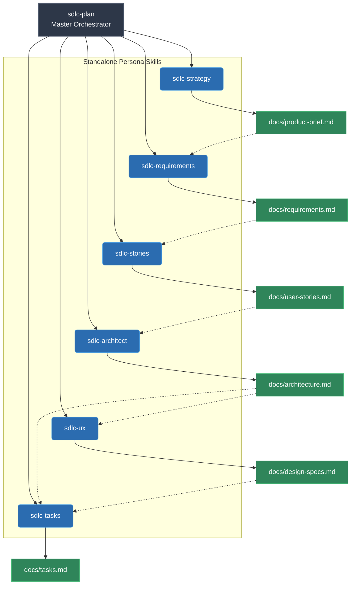

# AI Dev Pipeline

A structured AI-assisted development pipeline that covers the full SDLC — from a raw idea to PR review. Built as **Antigravity IDE skills** so the entire workflow runs natively inside your editor.

## How it works

The pipeline has **15 specialised agent personas** packaged as **14 skills** and 1 always-on rule. The 6 planning agents can be invoked individually as standalone skills or chained together via `sdlc-plan`. Instead of copy-pasting between separate AI chat windows, you invoke skills by name and the agent runs automatically.

```
Your idea
    ↓ "plan my project: [idea]"
product-brief.md → requirements.md → user-stories.md → architecture.md
    ↓ (has UI?) → design-specs.md
    ↓ → tasks.md
    ↓ "implement TASK-001"
Code + unit tests + handoff note
    ↓ "review TASK-001"
Code review → Security review (if applicable) → UX review (if applicable)
    ↓ "test TASK-001"
Full test suite + coverage matrix → task marked done
    ↓ "deploy TASK-001" (optional)
Dockerfile + CI/CD + deployment review
    ↓ "document TASK-001" (optional)
API docs + README update + changelog
    ↓ repeat for next task
```

## Scope: The Engineering Pillar

This pipeline focuses strictly on the **Software Development Life Cycle (SDLC)**. It is an engineering factory that turns an idea into working, tested, and deployable code.

It does **not** cover the other two pillars of creating a successful product:
1. **Business & Go-To-Market:** Market research, customer discovery, marketing, legal, or pricing.
2. **Operations & Support:** Customer support, community management, or analytics.

If you are looking to build the technical foundation of your product, this pipeline handles it end-to-end.

## Folder structure

```
.
├── .agents/                            # Antigravity customization root
│   ├── AGENTS.md                       # Always-on coding standards (Agent 6)
│   └── skills/
│       ├── sdlc-plan/SKILL.md          # Planning chain (Agents 0→1→2→3→4→5)
│       ├── sdlc-strategy/SKILL.md      # Product strategy (Agent 0) — standalone
│       ├── sdlc-requirements/SKILL.md  # Requirements analysis (Agent 1) — standalone
│       ├── sdlc-stories/SKILL.md       # User story writing (Agent 2) — standalone
│       ├── sdlc-architect/SKILL.md     # Architecture design (Agent 3) — standalone
│       ├── sdlc-ux/SKILL.md            # UI/UX design (Agent 4) — standalone
│       ├── sdlc-tasks/SKILL.md         # Task planning (Agent 5) — standalone
│       ├── sdlc-develop/SKILL.md       # Task implementation (Agent 6)
│       ├── sdlc-review/SKILL.md        # Code + Security + UX review (Agents 7→8→9)
│       ├── sdlc-test/SKILL.md          # Test generation (Agent 10)
│       ├── sdlc-deploy/SKILL.md        # DevOps review & artifacts (Agent 13)
│       ├── sdlc-docs/SKILL.md          # Documentation generation (Agent 14)
│       ├── pr-review/SKILL.md          # PR review at merge gate (Agent 11)
│       └── pr-triage/SKILL.md          # Large PR triage (Agent 12)
├── prompts/                            # Source of truth for all agent instructions
│   ├── 00-product-strategist.md       # Business thinking, MVP scope
│   ├── 01-requirements-analyst.md
│   ├── 02-user-story-writer.md
│   ├── 03-architect.md
│   ├── 04-ux-designer.md             # Design system, component specs, user flows
│   ├── 05-task-planner.md
│   ├── 06-developer.md
│   ├── 07-code-reviewer.md            # Includes Data & Schema review
│   ├── 08-security-reviewer.md        # Includes Regulatory Compliance
│   ├── 09-ux-accessibility-reviewer.md # WCAG 2.1 AA, responsive, UX
│   ├── 10-test-generator.md           # Enhanced performance testing
│   ├── 11-pr-reviewer.md
│   ├── 12-large-pr-triage.md
│   ├── 13-devops-agent.md             # Dockerfile, CI/CD, IaC
│   └── 14-documentation-agent.md      # API docs, README, changelog
└── docs/                               # Living project documents (pipeline outputs)
    ├── product-brief.md                 # Agent 0 output
    ├── requirements.md                  # Agent 1 output
    ├── user-stories.md                  # Agent 2 output
    ├── architecture.md                  # Agent 3 output
    ├── design-specs.md                  # Agent 4 output (conditional — UI projects only)
    ├── tasks.md                         # Agent 5 output — your task backlog
    ├── handoffs/                        # Agent 6 handoff notes per task
    ├── reviews/                         # Agent 7+8+9 review reports per task
    ├── test-reports/                    # Agent 10 test reports per task
    ├── deploy/                          # Agent 13 deployment reports per task
    └── documentation/                   # Agent 14 documentation reports per task
```

---

## Setup

### Antigravity IDE (recommended)

1. Copy this entire folder into your project root (or clone it)
2. Open the project in Antigravity IDE
3. The `.agents/` directory is discovered automatically — skills appear immediately
4. Start a conversation and say: `"plan my project: [your idea]"`

That's it. No Claude.ai Projects to configure, no API keys, no separate tools.

### Antigravity CLI (`agy`)

Works the same way — the `.agents/` directory is discovered automatically when you run `agy` from the project root.

---

## Workflow

### Phase 1: Planning (run once per project/feature)

Say: **"plan my project: [your idea or requirements]"**

The `sdlc-plan` skill chains up to six agents automatically:

| Step | Agent | Input | Output |
|------|-------|-------|--------|
| 0 | Product Strategist | Your raw idea | `docs/product-brief.md` |
| 1 | Requirements Analyst | Product brief | `docs/requirements.md` |
| 2 | User Story Writer | Requirements | `docs/user-stories.md` |
| 3 | Architect | User stories | `docs/architecture.md` |
| 4 | UI/UX Designer *(conditional)* | Architecture + stories + requirements | `docs/design-specs.md` |
| 5 | Task Planner | Architecture + stories (+ design specs) | `docs/tasks.md` |

After the chain completes, you review the full plan and approve or refine.

### Phase 2: Per-task development loop (repeat per task)

```
1. "implement TASK-NNN"     → sdlc-develop skill writes code + tests + handoff
2. "review TASK-NNN"        → sdlc-review skill runs code review (+ security + UX if needed)
3. Fix any review findings   → re-run "review TASK-NNN"
4. "test TASK-NNN"          → sdlc-test skill generates test suite + marks task done
5. "deploy TASK-NNN"        → sdlc-deploy skill generates deployment artifacts (optional)
6. "document TASK-NNN"      → sdlc-docs skill generates/updates documentation (optional)
7. Pick next task            → repeat
```

### Merge gate (before merging PRs)

| Situation | What to say |
|-----------|-------------|
| Normal PR | "review this PR" or "review PR #47" |
| Large PR (20+ files) | "triage this PR" first, then "review segment 1", "review segment 2", etc. |

### Modular usage: standalone planning skills

Each planning phase is also available as a **standalone skill** for individual use. This is useful when:

- You want to update only one planning artifact (e.g., regenerate UI specs for a new feature)
- You're adopting just one agent persona into a different project
- You want faster iteration without re-running the entire pipeline




| I want to... | Use this standalone skill |
|-------------|--------------------------|
| Define MVP scope and business risks | `sdlc-strategy` |
| Analyse and refine requirements | `sdlc-requirements` |
| Write user stories with Gherkin criteria | `sdlc-stories` |
| Design system architecture | `sdlc-architect` |
| Create UI/UX design specifications | `sdlc-ux` |
| Generate the task backlog | `sdlc-tasks` |
| Run the full end-to-end pipeline | `sdlc-plan` (orchestrates all of the above) |

**Portability**: To use any standalone skill in another project, copy its `.agents/skills/<skill-name>/` folder and the referenced prompt file from `prompts/` into your target project.

---

## The Complete Software Team (Agent personas)

The 15 agents map directly to a cross-functional real-world software team, covering every phase of the SDLC.

### 1. Product & Strategy
| # | Agent | Real-world role | Prompt |
|---|-------|----------------|--------|
| 0 | Product Strategist | Product Manager | `prompts/00-product-strategist.md` |
| 1 | Requirements Analyst | Business Analyst | `prompts/01-requirements-analyst.md` |
| 2 | User Story Writer | BA / Product Owner | `prompts/02-user-story-writer.md` |

### 2. Design
| # | Agent | Real-world role | Prompt |
|---|-------|----------------|--------|
| 3 | Architect | Solution Architect | `prompts/03-architect.md` |
| 4 | UI/UX Designer *(conditional)* | UI/UX Designer | `prompts/04-ux-designer.md` |
| 5 | Task Planner | Tech Lead | `prompts/05-task-planner.md` |

### 3. Core Development
| # | Agent | Real-world role | Prompt |
|---|-------|----------------|--------|
| 6 | Developer | Software Developer | `prompts/06-developer.md` |

### 4. Quality & Review (The Gatekeepers)
| # | Agent | Real-world role | Prompt |
|---|-------|----------------|--------|
| 7 | Code Reviewer | Senior Developer | `prompts/07-code-reviewer.md` |
| 8 | Security Reviewer | Security Engineer | `prompts/08-security-reviewer.md` |
| 9 | UX & Accessibility Reviewer | UX Engineer | `prompts/09-ux-accessibility-reviewer.md` |
| 10| Test Generator | QA / SDET | `prompts/10-test-generator.md` |

### 5. Release & Operations
| # | Agent | Real-world role | Prompt |
|---|-------|----------------|--------|
| 11| PR Reviewer | Senior Developer (merge gate) | `prompts/11-pr-reviewer.md` |
| 12| Large PR Triage | Tech Lead (PR triage) | `prompts/12-large-pr-triage.md` |
| 13| DevOps Agent | DevOps / SRE | `prompts/13-devops-agent.md` |
| 14| Documentation Agent | Technical Writer | `prompts/14-documentation-agent.md` |

## Skills reference

| Skill | Trigger phrases | What it does |
|-------|----------------|--------------|
| `sdlc-plan` | "plan my project", "start new project", "create requirements" | Chains Agents 0→1→2→3→(4)→5, writes all docs |
| `sdlc-strategy` | "define product strategy", "create product brief", "MVP scope" | Runs Agent 0 standalone → `docs/product-brief.md` |
| `sdlc-requirements` | "analyse requirements", "refine requirements" | Runs Agent 1 standalone → `docs/requirements.md` |
| `sdlc-stories` | "write user stories", "create stories", "generate acceptance criteria" | Runs Agent 2 standalone → `docs/user-stories.md` |
| `sdlc-architect` | "design architecture", "system design", "API contracts" | Runs Agent 3 standalone → `docs/architecture.md` |
| `sdlc-ux` | "design UI", "create design specs", "UX design" | Runs Agent 4 standalone → `docs/design-specs.md` |
| `sdlc-tasks` | "plan tasks", "create task backlog", "break down tasks" | Runs Agent 5 standalone → `docs/tasks.md` |
| `sdlc-develop` | "implement TASK-NNN", "build TASK-NNN" | Implements one task with self-review checklist |
| `sdlc-review` | "review TASK-NNN", "code review TASK-NNN" | Code review + conditional security review + conditional UX review |
| `sdlc-test` | "test TASK-NNN", "generate tests" | Full test suite + coverage matrix |
| `sdlc-deploy` | "deploy TASK-NNN", "generate Dockerfile", "create CI/CD" | Deployment artifacts + review |
| `sdlc-docs` | "document TASK-NNN", "generate docs", "update README" | API docs, README, changelog |
| `pr-review` | "review this PR", "review PR #47" | Three-layer PR review with verdict |
| `pr-triage` | "triage this PR", "this PR is too large" | Segments large PRs for reviewable chunks |

---

## Always-on rules

The coding standards from Agent 6 (Developer) are installed as `AGENTS.md` — they apply to **every** coding interaction in the workspace, not just when pipeline skills are active. This covers:

- Naming & readability conventions
- Error handling requirements
- Input validation standards
- Retry & resilience patterns
- Security practices
- Logging & observability standards
- Data & schema standards
- Unit test requirements

---

## Usage guide

### Scenario A: Brand new project (start from zero)

You have an idea but no code yet. Run the full pipeline from the beginning.

**Step 1 — Set up the pipeline**
```
# Option 1: Clone this repo and start fresh
git clone https://github.com/vdsperera/ai-dev-pipeline.git my-new-project
cd my-new-project
rm -rf docs/*

# Option 2: Copy into an empty project
mkdir my-new-project && cd my-new-project
git init
# Copy .agents/ and prompts/ from this repo into your project
```

**Step 2 — Plan your project**

Open the project in Antigravity IDE and say:

> "plan my project: I want to build a REST API for a task management app with user authentication, team workspaces, and real-time notifications"

The planning pipeline runs up to six agents in sequence:
1. **Product Strategist** → defines MVP scope, business model, and risk in `docs/product-brief.md`
2. **Requirements Analyst** → analyses your idea, finds gaps, writes `docs/requirements.md`
3. **User Story Writer** → creates user stories with Gherkin acceptance criteria in `docs/user-stories.md`
4. **Architect** → designs components, APIs, data models in `docs/architecture.md`
5. **UI/UX Designer** *(conditional)* → defines design system, page layouts, component specs in `docs/design-specs.md`
6. **Task Planner** → breaks everything into ordered atomic tasks in `docs/tasks.md`

Each phase pauses for your review. Say "continue" to proceed or give feedback to refine.

**Step 3 — Build task by task**

Once planning is complete, work through tasks in order:

```
"implement TASK-001"     → Agent writes code + unit tests + handoff note
"review TASK-001"        → Code review (+ security + UX review if applicable)
"test TASK-001"          → Full test suite generated, task marked done
"deploy TASK-001"        → Dockerfile + CI/CD generated (when ready to deploy)
"document TASK-001"      → API docs + README updated (when ready to document)

"implement TASK-002"     → next task...
```

**Step 4 — Merge and repeat**

When you're ready to merge a feature branch:
```
"review this PR"         → Three-layer PR review at the merge gate
```

---

### Scenario B: Existing project (adopt the pipeline into an already-built codebase)

You have a working project and want to add the pipeline for future development.

**Step 1 — Copy the pipeline files**
```
# Copy .agents/ and prompts/ into your existing project root
# Do NOT copy docs/ — you'll generate fresh docs for your codebase
```

**Step 2 — Generate baseline docs from your existing code**

You don't need to re-plan your whole project. Instead, generate documentation for what already exists:

> "document my existing project — scan the codebase and generate docs/architecture.md with the current component map, API contracts, and data models"

This gives the pipeline context about your existing system. You can also manually create or refine:
- `docs/architecture.md` — describe your current system design
- `docs/requirements.md` — document your current requirements (even briefly)

**Step 3 — Plan only new work**

When you need to add a feature, plan just that feature:

> "plan this feature: add real-time notifications using WebSocket for the existing task management API"

The planning agents will read your existing `docs/architecture.md` and plan the new feature within your existing system — they won't try to redesign what's already built.

**Step 4 — Use the development loop normally**

From here, the workflow is the same: implement → review → test → deploy → docs.

**Step 5 — Retroactive reviews (optional)**

You can run reviews on existing code without the full planning cycle:

> "review this PR" — for code about to be merged
> "review the code in src/auth/" — for an existing directory you want audited

---

### Scenario C: New feature on an existing project

You already have the pipeline adopted and want to add a new feature.

**Option 1 — Full planning (recommended for large features)**

> "plan this feature: add a billing module with Stripe integration, subscription management, and invoice generation"

This runs the full planning chain but scoped to the new feature. It reads your existing `docs/architecture.md` and designs the feature to fit within your existing system.

**Option 2 — Lightweight planning (for small features)**

Skip formal planning and go straight to implementation with a clear description:

> "implement this: add a GET /api/users/:id/activity endpoint that returns the last 50 activity events for a user, following our existing API patterns in src/routes/"

The Developer Agent (Agent 6) will follow the coding standards even without formal planning docs. Then review and test as normal.

**Which to choose?**

| Feature size | Approach |
|-------------|----------|
| Touches 1-2 files, simple logic | Option 2 — implement directly |
| Touches 3+ files, new API endpoints | Option 1 — plan first |
| New component, new data models | Option 1 — definitely plan first |
| New integration (payment, email, etc.) | Option 1 — plan first, security review will trigger |

---

### Scenario D: Bug fix or small change

Not every change needs the full pipeline. Here's how to handle lightweight work.

**Simple bug fix**
```
"fix this bug: the /api/tasks endpoint returns 500 when the user has no tasks. 
It should return an empty array with 200."
```
The coding standards from `AGENTS.md` apply automatically — error handling, input validation, and test quality are enforced even without invoking any skill.

**Quick refactor**
```
"refactor the authentication middleware to use the new token validation library. 
Don't change any behaviour, just swap the implementation."
```

**When to add reviews**

| Change type | Review? | Test? | Deploy? | Docs? |
|-------------|---------|-------|---------|-------|
| One-line bug fix | Skip | Skip | Skip | Skip |
| Bug fix touching auth/payments | Review ✅ | Optional | Skip | Skip |
| Refactor (no behaviour change) | Optional | Test ✅ (verify no regression) | Skip | Skip |
| Config/env change | Skip | Skip | Deploy ✅ | Docs ✅ |
| New API endpoint | Review ✅ | Test ✅ | Deploy ✅ | Docs ✅ |

---

### Scenario E: Team workflow

When multiple developers use the pipeline on the same project.

**Branch strategy**
```
main
├── feature/TASK-001-user-auth      ← one branch per task
├── feature/TASK-002-database-setup
└── feature/TASK-003-api-endpoints
```

**Per-developer workflow**
1. Pick a task from `docs/tasks.md`
2. Create a feature branch
3. Run: `"implement TASK-NNN"` → `"review TASK-NNN"` → `"test TASK-NNN"`
4. Push and create a PR
5. Run: `"review this PR"` (or have another team member trigger it)
6. Merge

**Keeping docs/ in sync**
- `docs/` lives in version control — it's the shared source of truth
- Each task updates its own files: `docs/handoffs/TASK-NNN.md`, `docs/reviews/TASK-NNN-*.md`
- `docs/tasks.md` is updated when a task is marked done — merge conflicts here are expected and easy to resolve
- `docs/architecture.md` should only be changed through the planning pipeline or explicit architecture discussions — not by individual task implementations

**PR review workflow**
```
Developer pushes PR
    ↓
Reviewer (human or AI) says: "review this PR" or "review PR #47"
    ↓
PR Review agent runs three layers:
  Layer 1: Mechanical checks (bugs, security, hygiene)
  Layer 2: Engineering reasoning (concurrency, resilience, caching)
  Layer 3: System judgment (architecture, scale, blast radius)
    ↓
Verdict: Approved / Approved with comments / Request changes / Escalate
    ↓
Large PRs (20+ files): "triage this PR" first to split into reviewable segments
```

**Parallel task execution**
- Tasks declare dependencies in `docs/tasks.md` — respect the `Depends on` field
- Independent tasks can be worked in parallel by different developers
- The pipeline prevents implementing a task whose dependencies aren't done

---

### Quick reference: what to say for each scenario

| I want to... | Say this |
|-------------|---------|
| Start a new project | "plan my project: [your idea]" |
| Add the pipeline to existing code | Copy `.agents/` + `prompts/`, then "document my existing project" |
| Plan a new feature | "plan this feature: [feature description]" |
| Implement a task | "implement TASK-NNN" |
| Review code | "review TASK-NNN" |
| Generate tests | "test TASK-NNN" |
| Generate deployment artifacts | "deploy TASK-NNN" |
| Generate documentation | "document TASK-NNN" |
| Review a PR | "review this PR" or "review PR #NNN" |
| Triage a large PR | "triage this PR" |
| Fix a bug | Just describe the bug — coding standards apply automatically |

---

## Updating prompts

Prompts are the source of truth — skills reference them. To update agent behaviour:

1. Edit the relevant file in `prompts/`
2. Commit the change: `improve: tighten input validation rules in developer agent`
3. The skills will read the updated prompt on the next invocation — no other changes needed

---

## Tips

- **One task per conversation** — don't pile multiple tasks into one conversation
- **Review the plan before implementing** — the planning chain pauses for your approval
- **Security review is automatic** — it triggers when code touches auth, payments, or PII
- **UX review is automatic** — it triggers when code touches UI components or styling
- **Deploy and docs are optional** — run them when deployment artifacts or documentation updates are needed
- **The review agents are optional for simple tasks** — skip them for trivial changes
- **Keep docs/ in version control** — they provide context for future development
- **Prompts are the source of truth** — edit `prompts/` to change agent behaviour; skills reference them automatically
- **Start light, add rigour as needed** — for a quick fix, just describe it; for a large feature, run the full pipeline

---

## Under the Hood: Antigravity Architecture

If you want to customize this pipeline (add new agents, change the rules, or integrate external tools), you need to understand how the underlying Antigravity architecture processes a request.

It works like a funnel: your request comes in, gets shaped by Hooks and Rules, gets routed to a Skill (which loads a Prompt), and then uses MCP tools to execute the actual work.


### The Role of Each Component:

**1. Hooks (`hooks.json`) — The Interceptors**
Hooks act as triggers on specific system events. For example, a `pre_message` hook can intercept your text before the AI sees it (to format it or add context), or a hook can run a script every time a file is saved. 

**2. Rules (`.agents/AGENTS.md`) — The Subconscious Constraints**
Before the AI even thinks about your request, these are loaded into its memory. It is the "always-on" layer. It guarantees that no matter what the AI does next, it will obey your coding standards, commit formatting, and security rules.

**3. Skills (`.agents/skills/*/SKILL.md`) — The Workflow Manager**
The system checks the "triggers" inside every `SKILL.md` to see if your request matches one. If it does, the AI abandons its default chat mode and enters **Skill Mode**. The `SKILL.md` gives the AI a strict checklist: what files to read first, what order to do things in, and where to save the output.

**4. Prompts (`prompts/*.md`) — The Persona's Brain**
The `SKILL.md` usually says, *"Go read this specific prompt file to learn how to do your job."* This is where the deep, specialized instructions live (like exactly how the Architect should design a database). By separating this from the Skill, multiple skills can share the same persona.

**5. MCP Servers (`.agents/mcp_config.json`) — The Hands & Senses**
While executing the skill, the AI might need to look outside its normal boundaries. MCP (Model Context Protocol) servers grant the AI specific external tools. If the Architect needs to read a GitHub repo to understand an existing API, it uses the GitHub MCP.

---

## Related Projects

This pipeline is part of a larger suite of AI tools designed to automate an entire software business. 

*   [**ai-dev-pipeline**](https://github.com/vdsperera/ai-dev-pipeline) (This repo): The Engineering Pillar (SDLC).
*   **ai-gtm-pipeline** *(Coming Soon)*: The Business & Go-To-Market Pillar. Automates marketing, campaign strategy, pricing, and SEO.
*   **ai-ops-pipeline** *(Coming Soon)*: The Operations & Support Pillar. Automates customer support triage, bug reporting, and churn analysis.
