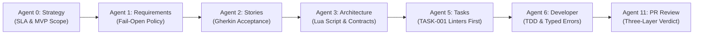
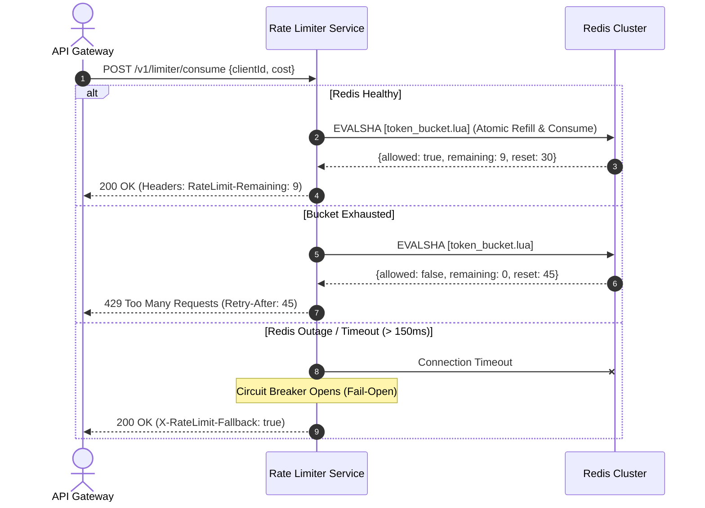

# Case Study 01: Greenfield Microservice Design
## Building a High-Throughput Token Bucket Rate Limiter with Zero Architectural Drift

> **Context**: Greenfield microservice development  
> **Tech Stack**: TypeScript, Node.js, Redis, Docker, Vitest  
> **Goal**: Design, architect, and implement a distributed, low-latency Rate Limiter microservice capable of enforcing multi-tenant rate limits across millions of requests per day.

---

## The Challenge

When engineering teams ask an unguided AI to build a microservice from scratch, common failures emerge within hours:
1. **Concurrency Blindness**: The AI uses simple `GET` and `SET` operations on Redis, introducing race conditions under high concurrent traffic.
2. **Missing Failure Modes**: The AI assumes Redis is always 100% available and has no circuit breaker or fallback policy when the cache goes down.
3. **API Contract Drift**: As new endpoints are added, status codes, header names (e.g., `X-RateLimit-Remaining` vs `RateLimit-Remaining`), and error payloads drift randomly.

The **AI Dev Pipeline** prevents these failures by enforcing a phased SDLC lifecycle with explicit architectural contracts before any implementation code is generated.

---

## The Phased Pipeline Execution



---

### Phase 1: Product Strategy (`sdlc-strategy` / Agent 0)

The engineer initiates the project with a high-level goal:
> *"We need a distributed rate limiting microservice for our public API gateway."*

**Agent 0 (Product Strategist)** produces `docs/product-brief.md`:
* **Core Problem**: Protect downstream microservices from traffic surges, brute-force credential stuffing, and noisy neighbors without adding more than 5ms of p99 latency overhead.
* **Tiering Model**:
  * Free Tier: 60 requests/minute, burst up to 100.
  * Pro Tier: 1,000 requests/minute, burst up to 1,500.
  * Enterprise Tier: Custom configurable bucket capacity and refill rate.
* **Non-Goals (MVP Boundary)**: Geo-distributed multi-region Redis replication (deferred to Phase 2 to prevent scope creep).

---

### Phase 2: Requirements Analysis (`sdlc-requirements` / Agent 1)

**Agent 1 (Requirements Analyst)** interrogates edge cases and boundary conditions, producing `docs/requirements.md`:
* **Functional Requirements**:
  * `FR-001`: Consume `N` tokens from a client's bucket given `clientId` and `endpointKey`.
  * `FR-002`: Return standard IETF draft headers: `RateLimit-Limit`, `RateLimit-Remaining`, and `RateLimit-Reset`.
  * `FR-003`: When exhausted, return HTTP `429 Too Many Requests` with a mandatory `Retry-After` header.
* **Critical Failure Mode (Graceful Degradation)**:
  * What happens if Redis times out or crashes?
  * **Requirement Decision**: **Fail-Open with Alerting**. A rate limiter outage must *never* take down the primary business API. If Redis is unreachable for > 150ms, allow the request, increment a fallback metric, and log a high-priority warning.

---

### Phase 3: User Stories & Acceptance Criteria (`sdlc-stories` / Agent 2)

**Agent 2 (User Story Writer)** translates requirements into unambiguous Gherkin acceptance criteria in `docs/user-stories.md`:

```gherkin
Feature: Token Consumption

  Scenario: Request within allowance
    Given client "tenant-123" has 10 tokens remaining
    When a request arrives consuming 1 token
    Then the response status is 200 OK
    And the header "RateLimit-Remaining" is "9"

  Scenario: Bucket exhausted
    Given client "tenant-123" has 0 tokens remaining
    When a request arrives consuming 1 token
    Then the response status is 429 Too Many Requests
    And the header "Retry-After" indicates the refill duration in seconds
    And the response body contains a structured error with code "RATE_LIMIT_EXCEEDED"

  Scenario: Cache failure fallback
    Given the Redis cache is unreachable or times out after 150ms
    When a request arrives consuming 1 token
    Then the response status is 200 OK
    And the header "X-RateLimit-Fallback" is "true"
    And a warning is logged with the correlation ID
```

---

### Phase 4: System Architecture (`sdlc-architect` / Agent 3)

**Agent 3 (Architect)** designs the concrete technical contract in `docs/architecture.md`:



#### Key Architectural Invariants Enforced:
1. **Atomic Concurrency**: Tokens are refilled and decremented inside a single **Redis Lua script** executed via `EVALSHA`. No individual `GET`/`SET` calls are permitted, eliminating race conditions across worker nodes.
2. **Circuit Breaker**: An in-memory circuit breaker wraps the Redis client with an exponential backoff probe every 5 seconds.
3. **Data Schema**:
   * Redis Key: `ratelimit:{tenantId}:{endpoint}` (Hash containing `tokens`, `last_refill_ts`).
   * TTL: Equal to `2 * refill_period` to prevent orphan keys.

---

### Phase 5: Task Planning (`sdlc-tasks` / Agent 5)

**Agent 5 (Task Planner)** generates the ordered task backlog in `docs/tasks.md`. Crucially, it bootstraps quality tooling *before* application logic:

* `[x] TASK-001: Bootstrap Toolchain & Static Analysis`
  * ESLint strict config, TypeScript compiler strict mode (`noImplicitAny`, `strictNullChecks`), Docker Compose for local Redis test instance.
* `[ ] TASK-002: Implement Redis Lua Atomic Token Bucket Engine`
  * Linked Stories: `US-001`, `US-002`
  * Acceptance: Handles 5,000 concurrent requests without token count drift.
* `[ ] TASK-003: Implement Circuit Breaker & Fail-Open Resilience Layer`
  * Linked Stories: `US-003`
  * Acceptance: Bypasses Redis with fallback headers when cache is killed.
* `[ ] TASK-004: HTTP Gateway Endpoints & IETF Header Formatting`
* `[ ] TASK-005: End-to-End Stress Test Suite (5,000 req/sec benchmark)`

---

### Phase 6: Implementation (`sdlc-develop` / Agent 6)

When the engineer asks to implement `TASK-002`, **Agent 6 (Developer)** loads `AGENTS.md` and `docs/architecture.md`:

1. **Test-First Development**:
   * Writes Vitest unit tests simulating concurrent token requests against an in-memory Redis mock.
2. **Typed Custom Errors**:
   * Creates `RateLimitExceededError` and `StorageTimeoutError` extending a typed `BaseError`—zero generic `catch(e)` blocks.
3. **Zero Magic Numbers**:
   * All intervals, bucket limits, and timeouts reference typed configuration constants:
     ```typescript
     export const DEFAULT_BURST_CAPACITY = 60;
     export const REDIS_TIMEOUT_MS = 150;
     export const CIRCUIT_BREAKER_RESET_SEC = 5;
     ```

---

### Phase 7: PR Review & Gatekeeping (`pr-review` / Agent 11)

Before code can be merged into `main`, **Agent 11 (PR Reviewer)** executes its 3-layer audit:

* **Layer 1: Mechanical Findings**: Zero unused imports, strict TypeScript adherence, 100% test pass rate.
* **Layer 2: Engineering Questions**: Confirms that Redis key expiration TTL is calculated dynamically based on bucket refill rates.
* **Layer 3: System Flags**: Validates that no unparameterized string concatenation was used in Redis key generation (preventing key injection).
* **Verdict**: **APPROVED (Ready to Merge)**.

---

## What Made This Different from Unguided AI Coding?

| Unguided AI Generation | AI Dev Pipeline Greenfield Process |
|---|---|
| AI immediately generates 300 lines of messy Express code with `GET`/`SET` race conditions. | Architecture contract created **first**: Lua script mandated to ensure atomic decrement under concurrency. |
| Ignores cache outages; application crashes if Redis container stops. | Explicit **Fail-Open Policy** designed in requirements and verified with a unit test. |
| Hardcodes numbers (`10`, `60`, `1000`) throughout routes. | Strictly enforces named constants and typed error classes via `AGENTS.md`. |
| Future engineers have no idea how the system works. | Complete living documentation generated automatically: `docs/architecture.md`, `docs/user-stories.md`, and `docs/handoffs/TASK-002.md`. |

---

## Result

* **p99 Latency**: 2.8ms (well within the < 5ms SLA).
* **Test Coverage**: 98% line coverage across happy paths, exhausted buckets, and simulated cache outages.
* **Engineering Time**: The entire specification, architecture contract, task backlog, and initial implementation were completed in **under 2 hours** with zero architectural regressions.
