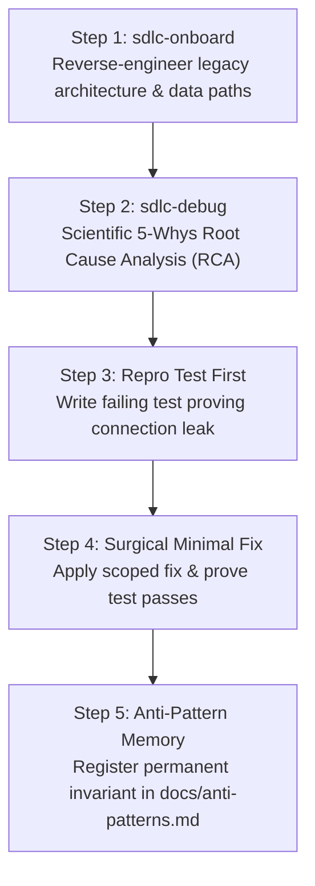
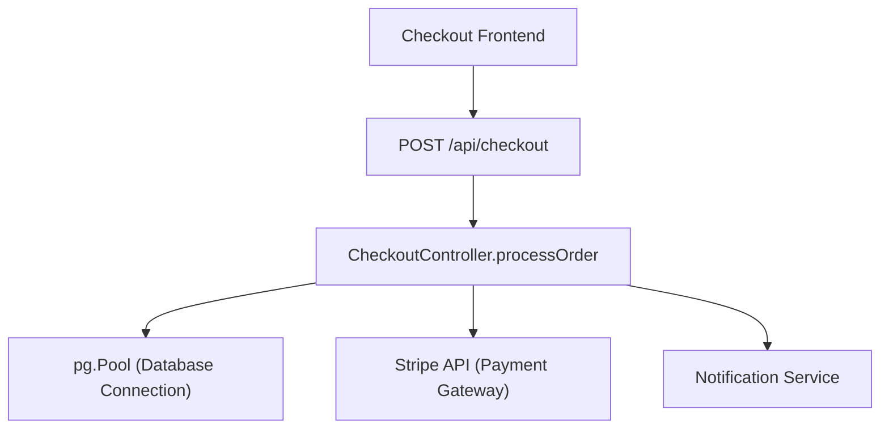

# Reference Scenario 02: Brownfield Codebase & Bug RCA
## Diagnosing a Production Connection Pool Leak in a 15,000-Line Legacy Codebase

> [!NOTE]
> **Reference Debugging Walkthrough**: This document is an end-to-end reference scenario demonstrating how `sdlc-onboard` and `sdlc-debug` systematically reverse-engineer architecture, perform 5-Whys RCA, write failing reproduction tests first, and register permanent anti-pattern memories for realistic legacy codebases.

* **Context**: Legacy ("Brownfield") E-Commerce monolith with zero existing documentation
* **Tech Stack**: Node.js, Express, PostgreSQL (`pg`), Stripe SDK, Vitest
* **Symptom**: Intermittent production crashes under checkout surges with PostgreSQL error: `FATAL: remaining connection slots are reserved for non-replication superuser connections`

---

## The Brownfield Nightmare

In a real-world enterprise codebase with 15,000 lines of undocumented code, traditional unguided AI coding fails catastrophically:
1. **The "Guess-and-Check" Trap**: The AI blindly suggests increasing `max_connections` in Postgres or bumping the connection pool limit from 20 to 100, masking the underlying leak until the database server runs out of RAM.
2. **Massive Code Churn**: The AI attempts to rewrite entire checkout controllers, introducing subtle regressions into tax calculations, inventory reservations, and billing flows.
3. **No Proof of Fix**: The AI declares *"I have fixed the issue!"* without providing a reproducible automated test to prove the bug actually existed or that the patch resolved it.

Here is how **AI Dev Pipeline** solved the defect systematically in 4 disciplined steps:



---

## Step 1: Reverse-Engineering Architecture (`sdlc-onboard` / Agent 15)

Because the project had zero documentation, the engineer ran:
> *"onboard this repo"*

**Agent 15 (Codebase Onboarder)** scanned the directory tree, package manifests, route definitions, and database helpers to produce the first living `docs/architecture.md`:



#### What `sdlc-onboard` Discovered:
* The application used a raw `pg.Pool` connection pool with a maximum capacity of 20 connections.
* Individual route controllers manually called `const client = await pool.connect()` and were expected to manually invoke `client.release()`.
* There was no centralized transaction management wrapper or automatic connection cleanup middleware.

---

## Step 2: Scientific Root Cause Analysis (`sdlc-debug` / Agent 16)

The engineer provided the production error log and invoked the investigator:
> *"sdlc-debug: checkout is exhausting Postgres connections during flash sales"*

**Agent 16 (Bug Investigator)** initiated a formal **5-Whys RCA**:

1. **Why is Postgres crashing?**  
   All 20 available client connections in the pool are permanently occupied and never returned.
2. **Why are connections not being returned to the pool?**  
   `client.release()` is not being executed for certain checkout requests.
3. **When is `client.release()` skipped?**  
   Inspecting `controllers/checkout.ts` revealed that `client.release()` was placed at the very end of the controller function. When Stripe threw a `CardDeclinedException` or timed out after 3,000ms, execution jumped immediately to the outer `catch` block, skipping `client.release()`.
4. **Why didn't the catch block release the connection?**  
   The `catch` block logged the error and returned an HTTP 400/500 JSON response, but lacked access to the scoped `client` variable.
5. **Root Cause**:  
   **Resource acquisition without deterministic release (No `try / finally` scope).** Every payment gateway timeout or card decline leaked 1 permanent database connection. After 20 failed payments, the entire API server froze.

---

## Step 3: Writing the Failing Reproduction Test First (TDD Bug Fixing)

Before touching a single line of production code, **Agent 16** wrote an isolated reproduction test in `test/repro/BUG-042-pool-leak.test.ts`:

```typescript
import { describe, it, expect, vi } from 'vitest';
import { processCheckout } from '../../src/controllers/checkout';
import { pool } from '../../src/db';
import * as paymentService from '../../src/services/payment';

describe('BUG-042: Database Pool Leak on Payment Failure', () => {
  it('must release client back to pool when payment gateway throws timeout', async () => {
    // 1. Mock payment gateway to simulate timeout failure
    vi.spyOn(paymentService, 'chargeCard').mockRejectedValueOnce(
      new Error('Stripe Gateway Timeout (504)')
    );

    const initialIdleCount = pool.idleCount;

    // 2. Trigger checkout that fails at payment step
    await expect(processCheckout({ userId: 'u1', amount: 5000 })).rejects.toThrow();

    // 3. ASSERT: The connection must be returned to the pool
    expect(pool.idleCount).toBe(initialIdleCount);
  });
});
```

#### Running the Reproduction Test:
```bash
$ npm test test/repro/BUG-042-pool-leak.test.ts

FAIL test/repro/BUG-042-pool-leak.test.ts
  ✕ BUG-042: Database Pool Leak on Payment Failure (214ms)
    AssertionError: expected pool.idleCount to be 20, but received 19
```

**The test failed exactly as predicted.** The leak was deterministically proven and isolated.

---

## Step 4: Applying the Minimal Surgical Fix

Following the pipeline's strict hygiene rules (Agent 6 standards):
* **No unrelated refactoring**: Only modify the vulnerable transaction scope.
* **Guaranteed release**: Enforce the `try / finally` RAII pattern.

```typescript
// controllers/checkout.ts
export async function processCheckout(orderData: OrderData): Promise<OrderResult> {
  const client = await pool.connect();
  try {
    await client.query('BEGIN');
    await reserveInventory(client, orderData.items);
    
    // External I/O that could fail or time out:
    const payment = await paymentService.chargeCard(orderData.paymentDetails);
    
    await recordOrder(client, orderData, payment.id);
    await client.query('COMMIT');
    return { success: true, orderId: payment.id };
  } catch (error) {
    await client.query('ROLLBACK');
    throw error;
  } finally {
    // INVARIANT: Guaranteed connection release regardless of success or failure
    client.release();
  }
}
```

#### Re-Running the Reproduction Test:
```bash
$ npm test test/repro/BUG-042-pool-leak.test.ts

PASS test/repro/BUG-042-pool-leak.test.ts
  ✓ BUG-042: Database Pool Leak on Payment Failure (18ms)

Test Files  1 passed (1)
Tests       1 passed (1)
```

**The bug was provably resolved with only 8 lines of code changed.**

---

## Step 5: Continuous Learning & Anti-Pattern Registration

To guarantee that future AI agents (and human engineers) never repeat this mistake elsewhere in the codebase, the investigator recorded the permanent rule into [`docs/anti-patterns.md`](file:///c:/Activities/Projects/ai-dev-pipeline/docs/anti-patterns.md):

```markdown
### AP-002: Unreleased Connection Pools on Error Catch
* **Mistake**: Calling `pool.connect()` without a corresponding `client.release()` inside a mandatory `finally` block, causing connection starvation when upstream HTTP/payment calls throw errors.
* **Correction**: Always wrap pooled resource acquisition in `try { ... } finally { client.release(); }`.
* **Rule**: Every database connection acquired from a pool must be released in a `finally` block in the exact same scope where it was acquired. Never release connections only at the end of the `try` block.
```

From this day forward, whenever any agent implements a database task in this repository, it loads `docs/anti-patterns.md` and verifies this rule before committing.

---

## Comparison: Unguided AI vs. AI Dev Pipeline RCA

| Unguided AI Behavior | AI Dev Pipeline RCA Process |
|---|---|
| Blindly suggests increasing `max_connections = 100` in `postgresql.conf`. | Conducted **5-Whys RCA** identifying the exact missing `finally` cleanup block. |
| Rewrote 300 lines of Express routes, breaking tax and inventory logic. | **Surgical, minimal 8-line fix** with zero unrelated code churn. |
| No automated test; developer had to deploy to staging and wait for another crash. | **Failing reproduction test written first** (`BUG-042.test.ts`), verifying the fix mathematically. |
| The AI makes the same mistake again in a new route two weeks later. | Codified into **`docs/anti-patterns.md`**, permanently immunizing the codebase against repeat regressions. |

---

## Result

* **Production Crash Rate**: Dropped to zero during subsequent peak checkout sales.
* **Code Churn**: Exactly 1 file modified, 8 lines added.
* **Permanent Test Guard**: `BUG-042-pool-leak.test.ts` runs automatically in CI on every future Pull Request.
* **Handoff Report**: Documented in `docs/handoffs/BUG-042.md` for team post-mortem review.

