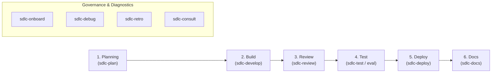

# AI Dev Pipeline — Capabilities Quick Reference

<!-- pipeline-template: quick-reference/v1 -->
_The fast-path task matrix for AI coding agents across Antigravity, Cursor, Claude Code, and Copilot._

---

## At a Glance: "What do you want to do?"

| Goal / Workflow | Recommended Skill | Persona / Role | Natural Language Trigger (Antigravity/Cursor) | Claude Code Command | Primary Artifact Produced |
| :--- | :--- | :--- | :--- | :--- | :--- |
| **Plan an entire feature/project** | `sdlc-plan` | Pipeline Orchestrator | *"plan my project: [idea]"* or *"fast-track plan: [feature]"* | `/sdlc-plan [idea]` | `docs/product-brief.md`, `requirements.md`, `user-stories.md`, `architecture.md`, `tasks.md` |
| **Define product brief & MVP scope** | `sdlc-strategy` | Agent 0 (Product Strategist) | *"define product strategy for [idea]"* | `/sdlc-strategy [idea]` | `docs/product-brief.md` |
| **Detect requirement ambiguities & NFRs** | `sdlc-requirements` | Agent 1 (Requirements Analyst) | *"analyse requirements for [feature]"* | `/sdlc-requirements [feature]` | `docs/requirements.md` |
| **Generate user stories with Gherkin** | `sdlc-stories` | Agent 2 (User Story Writer) | *"write user stories for [feature]"* | `/sdlc-stories [feature]` | `docs/user-stories.md` |
| **Design system architecture & ADRs** | `sdlc-architect` | Agent 3 (Architect) | *"design architecture for [feature]"* | `/sdlc-architect [feature]` | `docs/architecture.md` |
| **Design UI layouts & WCAG accessibility** | `sdlc-ux` | Agent 4 (UI/UX Designer) | *"design UI/UX for [feature]"* | `/sdlc-ux [feature]` | `docs/design-specs.md` |
| **Break down architecture into atomic tasks** | `sdlc-tasks` | Agent 5 (Task Planner) | *"plan task backlog"* or *"break down tasks"* | `/sdlc-tasks` | `docs/tasks.md` (bootstraps `TASK-001`) |
| **Implement a task from the backlog** | `sdlc-develop` | Agent 6 (Developer) | *"implement TASK-NNN"* or *"refactor TASK-NNN"* | `/sdlc-develop [TASK-NNN]` | Working code, unit tests, `docs/handoffs/TASK-NNN.md` |
| **Quick 1-turn bug fix or script tweak** | `sdlc-quick` | Agent 18 (Quick Developer) | *"quick fix: [issue]"* or *"tweak this script"* | `/sdlc-quick [issue]` | Surgical code edit + verification test |
| **Comprehensive code review (9 categories)** | `sdlc-review` | Agents 7, 8, 9 (Reviewers) | *"review TASK-NNN"* or *"code review TASK-NNN"* | `/sdlc-review [TASK-NNN]` | `docs/reviews/TASK-NNN-code-review.md` |
| **Merge gate pull request review** | `pr-review` | Agent 11 (PR Reviewer) | *"review this PR"* or *"review PR #12"* | `/pr-review` | `docs/reviews/PR-NNN-review.md` (PASS/REJECT) |
| **Segment a giant PR for review** | `pr-triage` | Agent 12 (Large PR Triage) | *"triage this PR"* or *"this PR is too large"* | `/pr-triage` | `docs/reviews/PR-NNN-triage-plan.md` |
| **Generate unit, integration & E2E tests** | `sdlc-test` | Agent 10 (Test Generator) | *"test TASK-NNN"* or *"generate tests for TASK-NNN"* | `/sdlc-test [TASK-NNN]` | Test files + `docs/test-reports/TASK-NNN-test-report.md` |
| **Generate Dockerfile & CI/CD workflows** | `sdlc-deploy` | Agent 13 (DevOps Agent) | *"deploy TASK-NNN"* or *"generate CI/CD"* | `/sdlc-deploy [TASK-NNN]` | `Dockerfile`, `.github/workflows/`, `docs/deploy/` |
| **Generate API docs, README & changelog** | `sdlc-docs` | Agent 14 (Documentation Agent) | *"document TASK-NNN"* or *"generate docs"* | `/sdlc-docs [TASK-NNN]` | `README.md`, `CHANGELOG.md`, `docs/documentation/` |
| **Reverse-engineer existing/brownfield code** | `sdlc-onboard` | Agent 15 (Codebase Onboarder) | *"onboard this repo"* or *"scan existing codebase"* | `/sdlc-onboard` | `docs/architecture.md` (anti-hallucination verified) |
| **Scientific 5-Whys root cause debugging** | `sdlc-debug` | Agent 16 (Bug Investigator) | *"debug this: [symptom]"* or *"investigate error"* | `/sdlc-debug [symptom]` | Failing test first, fix, `docs/handoffs/BUG-NNN.md` |
| **Audit architectural trade-offs & 100x scale** | `sdlc-retro` | Agent 17 (Architectural Retro) | *"audit design choices"* or *"prepare me to explain this"* | `/sdlc-retro` | `docs/architecture-retro.md` |
| **Debate tech dilemma (Architect vs Dev vs Sec)** | `sdlc-consult` | Agent 19 (Trade-Off Consultant) | *"consult: [dilemma]"* or *"debate this decision"* | `/sdlc-consult [dilemma]` | Trade-off matrix & pre-drafted ADR in `docs/architecture.md` |

---

## The 7 SDLC Lifecycle Phases



### Phase 1: Product Strategy & Planning
- **`sdlc-plan`**: Chains Product Strategist (0) → Requirements Analyst (1) → User Story Writer (2) → Architect (3) → UI/UX Designer (4, conditional) → Task Planner (5). Also supports lightweight fast-track: Analyst → Tasks.
- **`sdlc-strategy`**: Defines target users, core value proposition, MVP scope, and business risks into `docs/product-brief.md`.
- **`sdlc-requirements`**: Uncovers hidden edge cases, ambiguities, boundary conditions, and NFRs in `docs/requirements.md`.
- **`sdlc-stories`**: Converts requirements into INVEST user stories with Gherkin scenarios in `docs/user-stories.md`.
- **`sdlc-architect`**: Establishes system design, component boundaries, API contracts, and ADRs in `docs/architecture.md`.
- **`sdlc-ux`**: Produces component specs, responsive layouts, design tokens, and WCAG accessibility guidelines in `docs/design-specs.md`.
- **`sdlc-tasks`**: Plans an atomic, dependency-ordered task backlog in `docs/tasks.md` and bootstraps `TASK-001` (toolchain/linters).

### Phase 2: Implementation & Development
- **`sdlc-develop`**: Implements code task-by-task. Enforces `AGENTS.md` coding law, writes unit tests, and creates `docs/handoffs/TASK-NNN.md`. Supports `[REFACTOR]` mode and flags architecture drift.
- **`sdlc-quick`**: Single-turn developer for surgical bug fixes, configuration tweaks, or minor updates without ceremony.

### Phase 3: Code & Security Review Gates
- **`sdlc-review`**: Runs a comprehensive 9-category review (Agent 7), OWASP Top 10 security audit (Agent 8), and UI accessibility check (Agent 9).
- **`pr-review`**: Merge gate inspection evaluating mechanical findings, engineering questions, and system flags to deliver a formal PASS or REJECT verdict.
- **`pr-triage`**: Pre-review segmentation that breaks large pull requests (> 400 lines) into isolated, reviewable chunks.

### Phase 4: Testing & Objective Hygiene Evaluation
- **`sdlc-test`**: Generates full test suites (unit, integration, E2E, performance) and outputs coverage matrices into `docs/test-reports/`.
- **`ai-dev-pipeline eval` (CLI)**: Tier 3 objective static hygiene evaluator that checks layer contracts, linter clean status, cyclomatic nesting depth, and anti-pattern regressions.

### Phase 5: DevOps & Deployment
- **`sdlc-deploy`**: Produces multi-stage Dockerfiles, CI/CD pipeline definitions (GitHub Actions/GitLab CI), IaC templates, and deployment reviews in `docs/deploy/`.

### Phase 6: Documentation & Synchronization
- **`sdlc-docs`**: Keeps documentation evergreen by updating `README.md`, API documentation, `CHANGELOG.md`, and flagging stale docs.
- **`ai-dev-pipeline sync` (CLI)**: Re-synchronizes standards from `.agents/AGENTS.md` across Antigravity, Cursor, Claude Code, and Copilot.

### Phase 7: Brownfield, RCA & Architectural Governance
- **`sdlc-onboard`**: Reverse-engineers un-documented or legacy codebases, extracts implicit ADRs, and populates `docs/architecture.md`.
- **`sdlc-debug`**: Scientific bug investigator that follows 5-Whys root cause analysis, writes a failing reproduction test *before* editing code, applies a minimal fix, and registers anti-pattern lessons.
- **`sdlc-retro`**: Audits past architectural decisions against recorded ADRs and commit churn, stress-tests 100x scaling limits, and prepares technical defense briefs.
- **`sdlc-consult`**: Triangulates Architect, Security Reviewer, and Developer viewpoints to resolve complex design crossroads with an ADR and trade-off matrix.

---

## Core CLI Commands

Run these directly from your terminal:

```bash
# 1. View capabilities catalog in your terminal (instant cheat sheet)
npx @kadvsperera/ai-dev-pipeline cheatsheet
# Filter by phase:
npx @kadvsperera/ai-dev-pipeline cheatsheet --phase=planning
# Search specific capabilities:
npx @kadvsperera/ai-dev-pipeline cheatsheet --search=debug
# Output as JSON:
npx @kadvsperera/ai-dev-pipeline cheatsheet --json

# 2. Check pipeline health & persona counts
npx @kadvsperera/ai-dev-pipeline status
npx @kadvsperera/ai-dev-pipeline status --global

# 3. Evaluate codebase hygiene & layer boundaries (Score 0-100%, Grade A+ to F)
npx @kadvsperera/ai-dev-pipeline eval
npx @kadvsperera/ai-dev-pipeline eval --since main
npx @kadvsperera/ai-dev-pipeline eval --task TASK-001 --threshold 90
npx @kadvsperera/ai-dev-pipeline eval --benchmark

# 4. Synchronize rules across all AI editors
npx @kadvsperera/ai-dev-pipeline sync
npx @kadvsperera/ai-dev-pipeline sync --global

# 5. Non-destructively stamp template tags & planning hashes
npx @kadvsperera/ai-dev-pipeline migrate

# 6. Scaffold into new or existing repository
npx @kadvsperera/ai-dev-pipeline init
npx @kadvsperera/ai-dev-pipeline init -y
```

---

## Cross-Tool Invocation Matrix

| AI Tool | How Skills Are Invocated | Where Rules Live | Overrides & Customization |
| :--- | :--- | :--- | :--- |
| **Google Antigravity** | Natural language trigger phrases (`"plan my project"`, `"debug this: ..."`, `"review TASK-001"`) | `.agents/AGENTS.md` (or global plugin rules) | Edit `.agents/AGENTS.md` or append `AGENTS.local.md` |
| **Claude Code** | Native slash commands (`/sdlc-plan`, `/sdlc-develop`, `/sdlc-review`, etc.) | `CLAUDE.md` and `.claude/commands/` | Drop overrides in `prompts/overrides/<skill>.md` |
| **Cursor** | Composer chat or `@.cursor/rules/<skill>.mdc` | `.cursorrules` and `.cursor/rules/agents.mdc` | Edit rules in `.cursor/rules/` |
| **GitHub Copilot** | Agent mode chat using prompts in `.github/prompts/<skill>.prompt.md` | `.github/copilot-instructions.md` | Customize prompt files in `.github/prompts/` |

---

## Baseline Quality Laws (Always-On Invariants)

Regardless of which skill runs, the AI Dev Pipeline continuously enforces these baseline invariants across all tools:

1. **Typed Error Handling**: All I/O operations (DB, network, file) must be wrapped in specific, typed error handling. No silent empty `catch` blocks.
2. **Parameterized Queries**: Never concatenate external input into SQL, shell commands, or query strings.
3. **No Unbounded Queries**: All DB queries must be bounded (`LIMIT` / pagination). No N+1 queries.
4. **Zero Linter Errors**: Code must pass strict linter checks with zero warnings or errors.
5. **No `console.log` in Production**: Use structured logging with contextual metadata.
6. **Failing Test First for Bugs**: Never write bug fixes without a failing reproduction test.
7. **Anti-Pattern Memory**: Check `docs/anti-patterns.md` before coding; capture new mistakes after corrections.
8. **Atomic Code + Docs**: Every new feature, CLI command, or architectural change must update associated documentation in the same commit.

